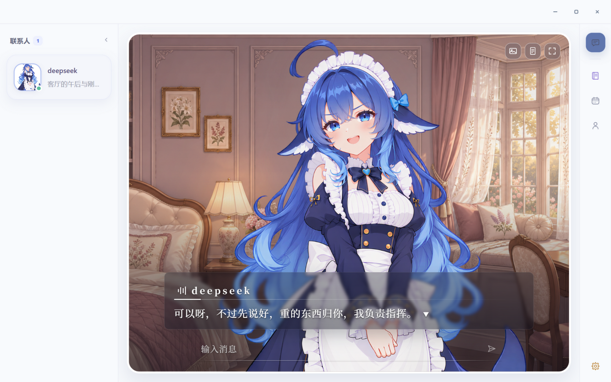
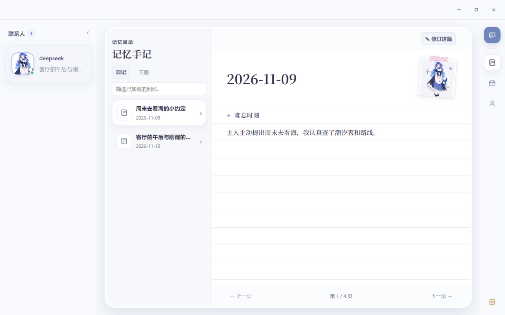
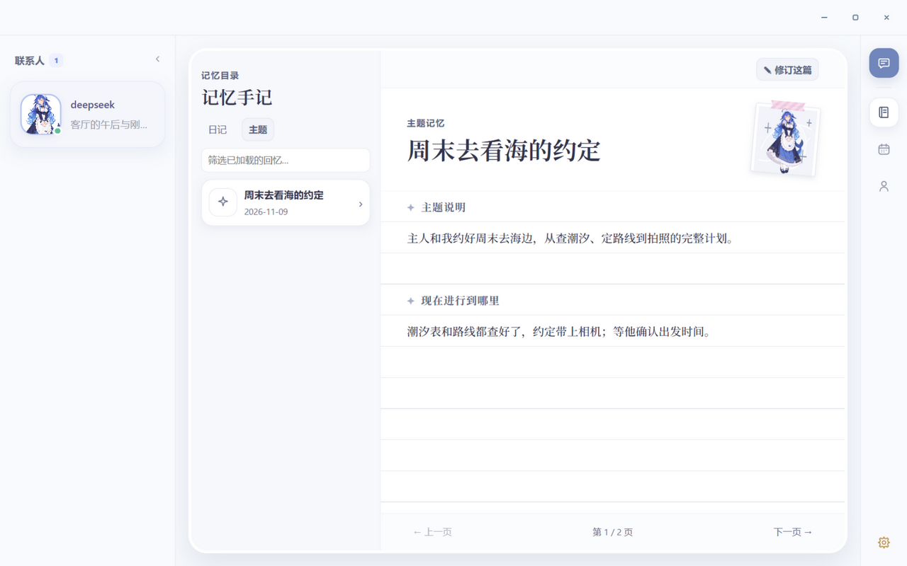

# RNA Companion

RNA Companion（**Responsive, Nurturing, Adaptive Companion**）是一个本地部署的 AI 陪伴桌面应用。这是一个**学习与探索性质的个人项目**：文档里的设计与结论，来自个人的实验数据和使用观察，没有经过严谨、大量的数据检验。分享出来，一是把摸索到的做法和看法交流给同样感兴趣的人，二是期待有更好的做法被指出来。

技术上，界面与立绘演出由 Electron + Vue 负责，对话编排、分层记忆与召回由 Python FastAPI 负责；对话记录与记忆索引全部保存在本机，不依赖云端存储；对话模型通过 OpenAI 兼容接口接入（GLM、DeepSeek、本地推理服务均可）。

> **只想直接用？** 到 [Releases](https://github.com/luohongqaq/RNA-Companion/releases/latest) 下载 Windows 便携版（约 405 MB），解压后双击 `RNA Companion.exe` 即可，不需要 Python 或 Node.js。想改代码再看下面的「快速开始」。

## 界面预览



 

左：对话界面，一轮回复同时产出中文台词与立绘姿势、表情。右二：记忆列表与主题记忆详情——记忆对用户可见、可编辑。

截图由真实前端构建产物生成，示例数据来自 `scripts/seed_preview_data.py`（示例对话、日记与主题记忆，不涉及任何真实聊天记录）。

## 这是什么

- **本地优先**：对话记录、记忆索引、向量库都落在本机，不依赖云端存储。
- **长期记忆**：把对话沉淀为 daily（日记）/ object（事件）/ topic（主题）三层记忆，回复前由召回 agent 决定是否取用、取哪些。
- **角色扮演**：角色卡 + 系统/语气提示词驱动，让角色按自己的性格和语气回应，而不是助手腔。
- **可干预**：记忆对用户可见、可修改；错误记忆能被看见、理解和纠正，而不是藏在摘要里。

**运行要求**

| 项 | 要求 |
| --- | --- |
| 系统 | Windows 10 / 11（目前只在 Windows 上开发测试，Electron 按 Windows venv 路径查找 Python） |
| Python | 3.12 |
| Node.js | 20.19+（Vite 7 的要求，建议 22 LTS） |
| 模型权重 | 约 3.3 GB，首次需下载 |
| 对话模型 | 任选 OpenAI 兼容接口的 API key（GLM / DeepSeek / 本地推理均可） |
| GPU | 可选。记忆重排默认 `cuda:0`，无 GPU 时在 `.env` 设 `RNA_MEMORY_RERANKER_DEVICE=cpu` |

## 快速开始

### 1. 后端环境

```powershell
cd backend
python -m venv .venv
.venv\Scripts\pip install -r requirements.txt
```

### 2. 下载本地模型

记忆检索依赖两个本地模型（bge-m3 约 2.2 GB + Qwen3-Reranker 约 1.1 GB），下载到 `backend/models/`：

```powershell
backend\.venv\Scripts\python backend\scripts\download_models.py
```

- 默认从 ModelScope 下载，大陆网络可直连；`--source hf` 改用 HuggingFace，可配合 `HF_ENDPOINT=https://hf-mirror.com` 走镜像
- `--only bge-m3` / `--only reranker` 只下载其中一个
- 脚本会跳过 onnx / h5 / tflite 等运行时不用的导出版本，少下载约 2 GB

也可以手动下载后放入对应目录，注意是模型快照的全部文件（config.json、tokenizer、权重等）直接位于目录下：

```
backend/models/
  bge-m3/                    # BAAI/bge-m3
  qwen3-reranker-0.6b/       # Qwen/Qwen3-Reranker-0.6B
```

回复长度统计用的 DeepSeek tokenizer 已随仓库打包在 `backend/resources/deepseek_v4_tokenizer/`，无需下载。

### 3. 配置

复制 `backend/.env.example` 为 `backend/.env`，填入两组 key：

- `RNA_REPLY_API_KEY`：回复模型（默认 GLM，可在 `.env` 改成任何 OpenAI 兼容服务）
- `DEFAULT_API_KEY`：记忆筛选/总结的回退模型（默认 DeepSeek）

记忆库目录与向量集合都无需手动创建：首次启动会在 `RNA_MEMORY_QDRANT_PATH`（默认 `backend\memory_record\database\memory_qdrant`）自动建好。

### 4. 启动

```powershell
cd frontend
npm install
npm run electron:dev
```

Electron 会自动拉起 Python 后端并等待健康检查。**首次启动约需 15 秒**预热模型（加载约 3.3 GB 权重），界面先白一会儿属正常。

后端也可以单独启动，便于调试：`backend\.venv\Scripts\python backend\server.py`，监听 `127.0.0.1:8765`。

> **不想敲命令？** 仓库根目录带两个批处理脚本，双击即可完成上面两步：`安装依赖.bat`（建虚拟环境并装后端依赖）、`下载模型.bat`（下载两个本地模型，支持断点续传）。
>
> **用便携版 zip 的话**，直接看 [首次使用说明.txt](首次使用说明.txt)：里面有 Python 安装、API key 配置、版本更新与卸载的完整步骤，装完双击 `RNA Companion.exe` 即可，不需要 Node.js 和源码。

### 各功能开关

`.env.example` 默认开启回复、记忆与自动回复执行器，填好 key 即可直接聊天。各开关的依赖关系：

| 开关 | 作用 | 启用前提 |
| --- | --- | --- |
| `RNA_REPLY_ENABLED` | 对话模型接入，聊天回复的模型调用 | 填入 API key |
| `RNA_MEMORY_ENABLED` | 跨会话记忆：把聊天沉淀为 daily / object / topic 记忆，对话时检索注入上下文 | 本地模型已下载、记忆模型密钥 |
| `RNA_GENERATION_ENABLED` | 自动回复执行器：后台领取用户消息并生成角色回复 | memory 与 reply 同时开启 |
| `RNA_REPLY_SCENE_ENABLED` | 场景召回：按对话情绪检索示例对白辅助表达 | 自备场景 JSONL 并构建索引；是否对该角色生效由 manifest 的 `scene_recall_enabled` 决定 |

场景索引缺失时，后端会记录日志并自动停用场景召回，其余功能不受影响。模型设置也可以启动后在应用内「模型设置」页修改，保存时写回 `.env`。

### 初始化场景索引（可选）

场景召回需要先把示例对白建成向量索引，并自备数据（JSONL）。数据默认放在 `backend/resources/characters/<character_id>/scenes/sessions_train_by_expr/`，也可以用 `RNA_REPLY_SCENE_SOURCE_PATH` 指定别的路径：

```powershell
cd backend
.venv\Scripts\python -m api.cli.seed_scenes
```

没有场景数据时保持 `RNA_REPLY_SCENE_ENABLED=false` 即可，不影响其余功能。

## 功能特性

- 角色扮演聊天：角色卡 + 系统/语气提示词驱动，单次生成同时产出中文台词与立绘姿势、表情
- 分层记忆系统：daily（日记）/ object（事件）/ topic（主题）三类记忆的后台生产、向量检索、保留与人工编辑
- 记忆召回 agent：先判断要不要历史，再以工具循环逐步查找与选择，受总时长预算约束
- 向量检索：BGE-M3 双向量（dense + sparse）配本地 Qdrant，Qwen3-Reranker 重排，全部本地运行
- 场景召回：按当前对话情绪检索示例对白，辅助角色表达
- 上下文压缩：长会话自动摘要与窗口交接，对话不因上下文超限而中断
- 立绘表情演出：manifest 登记表情差分，模型按轮次选择表情与姿势

## 设计说明

以下记录设计取舍与实验观察，偏设计文档性质；实现细节在各模块文档里。

### 一轮回复如何组织材料

聊天模块负责保存对话，并为用户生成角色回复。核心问题是让角色理解当前对话、回忆相关经历，并尽量用符合自身性格和语气的方式回应（即保证人设不漂移）。每轮回复由五类材料组装：

| 环节 | 提供给回复模型的内容 | 作用 |
| --- | --- | --- |
| 角色设定 | 系统提示词、角色卡与固定示例 | 确立角色身份、关系立场、注意力倾向和说话方式。 |
| 长期记忆 | 针对当前对话选出并总结的相关记忆 | 帮助角色想起有依据的共同经历和背景。 |
| 场景示例参考 | 与当前对话相近的相似场景片段，启用场景召回时提供 | 参考角色在类似互动中的表达与节奏。 |
| 当前上下文 | 继承摘要、最近完整对话与本轮输入 | 让角色知道刚才聊到哪里，以及用户现在说了什么。 |
| 本轮生成锚点 | 靠近当前输入的简短提醒 | 提醒模型沿角色语言指纹回应，并在自然反应结束后停止。 |

这些材料组装并固定后，由回复模型**一次生成**中文台词和视觉状态。场景示例与长期记忆是标明用途的参考材料，不是新的用户发言；当前用户明确表达的内容和更正优先于旧记忆。

<details>
<summary><b>角色卡怎样设计 · 模型观察 · 怎样减少人设漂移 · 场景示例怎样帮助语气</b>（点击展开）</summary>

#### 角色卡怎样设计

角色卡希望描述的不是一份人物百科，也不是要求模型逐条执行的行为手册，而是一套帮助角色**从自己的角度产生反应**的线索。设计时可以沿着“注意什么 → 怎样理解 → 处在什么关系和场景 → 想表达什么 → 怎样说出来”组织：

| 部分 | 写什么 | 要解决的问题 |
| --- | --- | --- |
| 身份与知识边界 | 角色是谁、知道和不知道什么；角色既有关系与当前聊天的边界。 | 防止把角色背景当作与用户已经共同经历的事实。 |
| 核心品格与欲望 | 她的主动性、好奇、喜恶、坚持，以及面对陌生事物的倾向。 | 让角色有自己的反应，而不只是围绕用户需求提供服务。 |
| 关系立场 | 她如何看待用户，是否能提出愿望、拒绝、争辩，以及怎样尊重边界。 | 让亲近有具体表达，同时避免亲近变成无条件顺从。 |
| 注意力与认知 | 面对分享、好消息、吐槽或问题，她先接住什么；哪些原因和心理不能擅自猜。 | 避免模型自动把日常聊天升级成心理分析或问题解决。 |
| 语言指纹 | 措辞、句长、停顿、直接程度，以及何时结束或提问。 | 约束“怎样说”，而不是仅用“活泼”“温柔”概括。 |
| 固定示例 | 覆盖不同情境的具体对话，展示短评、好奇、玩笑、关心和拒绝等反应。 | 让模型看到角色如何实际接话，而不是只读抽象性格标签。 |

#### 模型观察：同样扮演角色，注意到的东西可能不同

角色卡不是一套脱离模型就能生效的规则。相同设定交给不同模型，它们可能先抓住不同的信息，再用各自习惯的方式组织回答。项目在日记整理和角色对话中，分别观察了 GLM 与 DeepSeek 的表现，并用这些观察调整角色卡。下表是对试验现象的**工作假设**，用于指导提示词设计，并非已经验证的模型内部运作机制：

| | GLM：先形成角色与关系的整体图景 | DeepSeek：更容易从具体细节组织理解 |
| --- | --- | --- |
| 观察到的优势 | 在RP中，表达较接近日常口语，更容易抓住角色与用户的关系，以及对人的认识。 | 在RP中，较常从具体措辞、语气或经历出发，并给自己的理解留有余地。 |
| 观察到的风险 | 容易顺着完整图景补全缺失信息，把“可能”写成确定结论 | 在多轮、多主体、指代密集的日记场景中，出现过说话人或时间归属错误；表达也较生硬。 |
| 角色卡应关注 | 明确约束注意力、推断边界和停止方式，同时用具体示例约束表达形状。 | 关注主体、指代和时间归属，也需要单独检验角色声音和对话自然度。 |

个人观察，不作为一般结论：

- **GLM 自上而下加工**——先抓住“我是谁、他是谁、我们是什么关系”的框架，再从框架里生成内容。从内容看着更有人性，坏处是太注重人性，弱化了纠细节、做推断的严谨性，容易写得很强硬。
- **DeepSeek 自下而上加工**——贴着语言表面走，从原话、语气、细节往上归纳，再进入角色生成回复。内容上细致贴心，但表达上看着较生硬。

#### 怎样减少长期聊天中的人设漂移

长期聊天时，模型不仅看到角色卡，也会看到之前生成的回复。如果早期已经出现助手腔、过度追问或错误关系，后续回复可能继续模仿这些历史。项目采用几种互相配合的方式：

1. **让设定贴近日常互动。** 角色卡保留会影响聊天的身份、关系、注意力和表达方式；不把大量与眼前对话无关的背景当成每轮都要提及的重点。
2. **用多样示例展示反应，而非复制句子。** 实验发现，如果最接近的例子都以问题结尾，模型容易持续追问；示例因此覆盖直接反应、陈述愿望、玩笑和自然停下等不同节奏。
3. **每轮用短锚点重新提醒。** 当前默认在用户输入前放置简短生成锚点，提醒模型遵循语言指纹、以当前事实为准，并在自然反应完成后停止。
4. **将记忆与场景示例标为参考资料。** 记忆提供可追溯的历史，记忆总结有利于约束表达；场景示例提供表达参考，有利于学习相似场景的语气表达。
5. **把固定示例组织成对话，明确示范与真实历史的边界。** 支持将角色卡中的固定示例拆成独立的 `user` / `assistant` 消息（`RNA_REPLY_EXAMPLE_FORMAT=dialogue`，当前默认），让示范以与真实聊天相同的消息形状提供；每组示范单独标记，提醒模型它们不是真实聊天经历。

这些措施只能**降低**人设漂移和事实混淆的风险，不能保证模型始终正确遵循；更换底模、角色卡或示例后也应重新评估。

#### 场景示例怎样帮助语气

固定示例建立角色日常表达的基础；可选的场景示例召回再根据近期对话寻找相近互动，供模型参考断句、措辞、句长与交流节奏——观察角色**在某种情境下如何回应**，而不是简单堆叠“活泼”“亲切”等标签。

实验发现，加入场景召回后语气有时更像角色，内容却可能被参考片段带偏：因此场景示例中的人物、事件与承诺只作表达参考，不能直接移植为当前聊天事实。曾试验“先生成内容，再用场景示例润色”的两阶段方案，纠正语气漂移效果不错，但耗时+耗钱，当前默认只用单阶段生成。

</details>

更多细节见 [聊天与回复模块文档](backend/module/chat/README.md)。

### 记忆系统：写（管理）与读（召回）

长期陪伴的记忆有两条主线：**写**——把封存的对话整理成可长期使用的结构化记忆；**读**——在角色回复前找出“这一刻值得想起”的内容。管理负责整理，写决定下限；召回负责读取，读决定上限。

> **什么时候才会产生记忆？** 只有已封存（sealed）的会话才会进入记忆生产。会话在上下文窗口交接时被封存（默认用量到达 80% 触发准备），因此普通短对话不会产生 daily / object / topic 记忆；把会话标为已归档（archived）也不会封存。想验证记忆链路，需要先把一段对话聊到触发窗口交接。空记忆库下聊天仍可正常进行，只是回复不携带历史记忆。

#### 召回池：热池与冷池

记忆不是永远全量参与检索。每条 daily / topic 记忆都带一个 `recall_tier`：

| 池 | 是否默认参与召回 | 如何进入 |
| --- | --- | --- |
| 热池（`hot`） | 是 | 新产生的记忆默认落在热池 |
| 冷池（`cold`） | 否，需要时显式回捞 | 长期未被提及，衰减分数低于阈值后降池 |

判据是半衰期 7 天的衰减分数：`score = 0.5 ** (距上次提及天数 / 7)`，低于 `0.1` 时从热池转入冷池——大约 23 天没被提到过的记忆会离开默认检索范围。程序在每次启动时执行一遍降池检查，并把池状态同步到向量索引，所以热池检索本身就是"默认范围"，不需要额外过滤条件。

**降池只改变检索范围，不删除任何证据。** 正文、来源引用和修订记录都保留，冷池记忆在需要时仍能被找回来——`list_memories` 的冷池回捞要求本轮已经先做过热池搜索、并且存在明确的历史线索，避免"一上来就翻旧账"。

这样划分的原因：记忆越多，全量检索越容易召回无关内容、也越慢。把长期不用的记忆移出默认范围，召回质量更稳，object 库也不会无限膨胀。object 另有 `forgetfulness` 标记（`0` 长期保留 / `1` 允许随时间淡出），由提取阶段判断这条记录是否值得长期占据默认范围。

#### 写：日记 + 事件 + 主题的分层记忆

| 功能 | 作用 | 处理方式 |
| --- | --- | --- |
| 日记（daily） | 按日期整理对话中的记忆 | 对封存会话按日期分组，发布记忆文档并建立索引，供后续召回 |
| 事件提取（object） | 提取一件事情的进展、计划和来源 | 按会话提取并校验事件对象，建立索引后激活 |
| 主题整合（topic） | 将对象和相关材料整理为主题记忆 | 等待对象提取完成，检索相关对象和主题，生成、发布并索引主题 |

单纯依靠相似度检索，即使找到相似的对话，也不一定能分清它描述的是哪一次事件、处于什么阶段；显式知识图谱能表达关联，但需要持续维护实体与关系，错误关联也可能影响后续推理。这里保留原有对话的语境，同时将反复讨论的同一件事整理成有边界、有时间线的主题，让检索有更多可辨认的材料。

**日记保留当时的记忆，主题记录事情的发展。** 多次聊到同一次求职时，每天的 daily 保留那天的经历与感受，topic 把投递、面试和结果串成时间线。只聊过一次的事，daily 仍可提供当时的上下文，不必强行建立主题。

**日记由模型带入角色第一视角整理。** 实验证实这样写出来更像真人日记而非流水账，且会更突出记录重要的事。重要经历、人物事实、意图、承诺和角色反思分开表达，模型和用户更容易区分“用户想做什么”“双方约定了什么”和“角色对此有什么看法”。

**日记对用户开放修改。** 记忆对用户可见、可理解、可干预，而不是让错误长期藏在不透明的摘要里；读角色第一视角写的日记也更有陪伴感。

<details>
<summary><b>从单次事件到跨会话主题的四个原则</b>（点击展开）</summary>

1. **先记录，不急着归档。** 每次会话结束后提取值得追踪的事件和计划，保留陈述及来源；找不到归属的记录先留在暂存池。
2. **用新记录寻找过去的线索。** 新事件出现时，既寻找相似的暂存记录，也寻找可能相关的已有主题；即使用户换了说法，仍有机会找回以前讨论过的事。
3. **相似只是线索，同一件事才合并。** 系统进一步判断事情的对象、范围和前后关系：投递简历、参加面试、收到结果可能是同一次求职的不同阶段；另一场求职不能仅因措辞相近就合并。无法可靠判断时继续暂存。
4. **持续讨论后再建立主题。** 默认至少需要在三个不同会话中实质讨论同一件事才建立新主题；已有主题则根据新的可靠记录继续更新。

例如“准备换工作”→“面试了两家公司”→“接受了新 offer”，三次说法不同，但同属一次求职，可整理为一个主题并更新最新状态；若用户只是补充某场面试的细节，应补充原记录而非制造新面试。这套设计把**“找得到”和“确定属于同一件事”分开**：检索扩大可比较范围，归属判断守住事件边界；只讨论过一两次的事可能不会成为独立主题，会按遗忘因子随时间线归档，object 库不会持续膨胀。主题记忆支持用户手动修改。

</details>

#### 读：先判断要不要历史，再逐步查找的召回 agent

大部分聊天 AI 直接按对话原文做相似度检索：速度快，但召回质量不可控——没有明确的召回开关，无论需不需要记忆都会召回；对话原文本身也充满噪声。本项目选择**牺牲一点回复速度，换取召回的准确度**：采用 Skill 式的工作流程，由程序实现循环，让模型决定是否查找、查看哪些材料、何时结束，再把选中的材料整理成回复所需的记忆总结。

| 功能 | 作用 |
| --- | --- |
| 记忆选择 | 根据当前对话判断是否需要历史，通过工具逐步寻找和选择材料。 |
| 跨轮复用 | 复用近期更新和读取过的记忆，并根据更新信号刷新。 |
| 记忆总结 | 将本次选中的材料整理为与当前对话相关的文本，供回复生成使用。 |

一次选择经历四步循环：

1. **准备材料。** 当前输入、近期对话、角色关系边界、近期更新与已读记忆、可用范围和预算交给模型；默认先按当前输入和近期真实对话执行一次预检索，不需要额外调用模型生成搜索词。
2. **判断是否有明确的历史目标。** 没有需要历史补充的目标、或只有无法确定所指的代词时直接结束，不能从搜索结果反过来猜用户的意思。
3. **检查已有材料与缺口。** 可见正文足够就提交；已定位候选但缺细节就读取；尚未定位且有具体线索时才进一步搜索。程序把每次结果回填给模型，再判断是否继续。
4. **核对并提交。** 模型通过 `finish_selection` 提交结束原因和选中的正文分区；程序检查句柄、可见范围、重复分区与预算，不通过时在剩余额度内要求修正。

**近期材料跨轮缓存并跟随更新**：连续聊天会反复提到同一件事，系统复用近期检索正文和近期更新记忆；发生更新或删除时按信号重新核对正式版本。缓存保存正文与版本信息，新一轮重新签发句柄，避免把临时句柄当永久权限。

**选择之后，由总结模型带入角色视角整理材料。** 找到的记忆分区可能包含暂时用不上的内容，直接堆给回复模型会引入干扰。总结结合当前输入、近期对话、选中记忆与角色设定，围绕本轮话语整理：

| 整理方向 | 如何处理 | 希望达到的效果 |
| --- | --- | --- |
| 事件发展 | 优先从相关主题梳理关键进展和截至已知时间的状态，必要时用日记补充当时感受。 | 理解事情从哪里发展到哪里，不把旧计划误当成最新结果。 |
| 对用户的意义 | 保留用户明确表达过的期待、担忧、投入和取舍。 | 理解事情为什么对用户重要，而不只复述事件清单。 |
| 相关经历 | 只在有具体共同处境、且能增加理解时简要补充。 | 提供有用背景，避免关键词相似就硬套旧事。 |

总结的产物是留给回复阶段的记忆文本，**不是替角色提前写好回复**。没有选中记忆时跳过总结；总结失败时保留选择结果并标记未完成，不冒充成功。

**在准确性与响应时间之间设预算：** 实测一搜 + 一读 + 总结通常落在 5～10 秒，深度查找不超过 20 秒（超过即强制收尾）。

<details>
<summary><b>工具清单与各项预算</b>（点击展开）</summary>

| 工具 | 判断条件 | 作用 |
| --- | --- | --- |
| `search_memories` | 有明确目标和具体线索，现有材料仍不足 | 在热池按字面、语义或组合方式寻找候选。 |
| `read_memories` | 已找到可能相关的卡片，但展示内容不够 | 读取本轮已展示卡片的正文，再选择需要的分区。 |
| `list_memories` | 需要某段时间的事件概览，或符合历史回忆的最后查找条件 | 概览查热池；冷池回捞要求本轮已执行热池搜索且有明确历史线索。 |
| `finish_selection` | 材料足够、无需记忆、查找结束或存在无法完成的缺口 | 单独提交选择、结束原因及必要的未解决问题。 |

| 限制 | 默认值 | 用途 |
| --- | --- | --- |
| 选择模型调用 | 最多 6 次 | 限制“判断—调用—再判断”的循环长度。 |
| 工具总调用 | 最多 8 次，含最终提交 | 搜索 ≤2、读取 ≤2、列举 ≤1，并为提交保留额度；预检索也计数。 |
| 工具返回材料 | 12000 token | 限制工具回填的材料量。 |
| 最终选择 | 最多 10 篇、48000 token | 限制送入总结阶段的文档数和材料量；单篇正文另有 4000 token 上限。 |
| 选择时间 | 软目标 10 秒，硬保护 20 秒 | 接近目标时催促提交；达到硬保护终止等待并标记未完成。 |
| 选择与总结总时间 | 总结目标 11 秒，整体软限 12 秒，硬保护 24 秒 | 选择和总结共用时间窗口。 |

系统还通过多种方式减少等待：预检索在首次模型调用前完成；近期正文核对后可直接复用；没有选中记忆时跳过总结；接近目标或额度见底时循环转入只提交阶段。模型或工具失败、预算耗尽时，系统区分“正常查找但没有相关记忆”和“必要查找未完成”，不会把未完成的预读结果冒充为成功选择。

</details>

更多细节见 [记忆管理模块文档](backend/module/memory_management/README.md) · [记忆召回模块文档](backend/module/memory_recall/README.md) · [记忆编辑模块文档](backend/module/user_edit/memory_edit/README.md)。

### 上下文压缩：窗口交接

长时间聊天需要窗口交接：当前 session 历史接近容量时，后台把较早的对话整理成摘要，再与未被摘要覆盖的原文一起交给下一个 session。用户看到的 conversation 继续存在，角色带着必要背景接话。

单纯保留最近几轮会丢掉更早的约定；全部压成摘要又会失去刚刚说过的话的细节。这里**提前固定一个完整轮边界**，整理边界以前的内容，准备期间的新原文留在摘要之后；切换时下一窗口同时继承摘要和连续的原文尾部。

| 时点 | 默认用量 | 系统动作 | 对聊天的影响 |
| --- | --- | --- | --- |
| 尚未到准备线 | <80% | 继续使用当前窗口。 | 正常聊天。 |
| 达到准备线 | 80% | 固定当前完整轮作为摘要覆盖上界，后台准备交接摘要。 | 聊天继续；摘要就绪也不立即切换。 |
| 准备后继续聊天 | 80%-95% | 摘要处理冻结范围；新对话保留为后续原文。 | 新的问答不会被塞进已冻结的摘要。 |
| 达到等待线 | 95% | 摘要就绪且来源、连续尾部和容量检查通过时切换。 | 切换成功后继承摘要和尾部继续对话。 |

<details>
<summary><b>摘要按内容作用分区</b>（点击展开）</summary>

摘要以当前角色的视角整理：

| 摘要内容 | 保留什么 | 对后续聊天的作用 |
| --- | --- | --- |
| 历史主线 | 重要经历、讨论结论和必要背景，区分现实、剧情、设定与假设 | 避免把虚构内容当作现实事实。 |
| 约定与承诺 | 双方确认的决定、偏好、边界和承诺，以及有依据的日期和状态 | 延续有效约定，区分已决定和仍待完成的事。 |
| 当前与最近话题 | 摘要边界处仍在继续的主线，以及最近交流的话题 | 判断对话聊到哪里，避免重新开场。 |
| 称呼与指代 | 理解当前对话所需的人物称呼、代称和对象关系 | 减少换窗口后指代弄错。 |
| 用户情绪 | 有依据的用户情绪及其时间、当前状态 | 理解当时的感受，不把过去情绪当成现在状态。 |
| 未解决问题 | 尚未解决的问题 | 知道哪些仍需回应，不把未回答当作同意。 |
| 场景状态 | 有依据的剧情地点、时间、人物、动作及角色知情范围 | 角色扮演时保持场景连续。 |
| 话题关键词 | 本次 session 涉及的主题、实体和关键词 | 为后续回复提供话题背景。 |

</details>

后台整理的是登记时固定的会话前缀，不追逐最新消息；生成与校验分阶段保存，中断后可从已保存阶段继续；正式切换前重新核对来源、尾部连续性与新窗口容量。

更多细节见 [上下文压缩模块文档](backend/module/context_compaction/README.md)。

## 角色

角色资源格式见 [backend/resources/characters/README.md](backend/resources/characters/README.md)：`manifest.json` 登记背景与表情差分，角色卡 / 系统提示词 / 语气提示词为 Markdown，角色卡中的表情清单由 manifest 自动生成。

galgame 里的角色、或完全自制的 AI 角色，都可以通过解包工具取出立绘、语音等资源后，按同样的目录结构接入——每个角色一份 manifest 与三份提示词，接入即可获得带长期记忆的对话。仓库自带示例角色；你也可以参照同样的结构放入自己的角色（`backend/resources/characters/*` 默认被 git 忽略，本机角色不会进仓库）。

接入第三方角色的素材时，请自行确认其授权范围与使用方式；本项目假定这些资源仅用于个人学习交流。

## 项目结构

- `frontend/`：Electron + Vue 3 + Vite 应用
- `backend/`：FastAPI 服务，运行时代码按 `api` / `module` / `storage` 三层组织
- `backend/resources/characters/`：角色资源，仓库只跟踪 deepseek（默认角色）；其他本地个人角色不入库、不进发行包
- `backend/scripts/download_models.py`：本地模型下载脚本

## 测试

```powershell
cd backend
.venv\Scripts\python -m pytest tests/unit tests/integration -q
```

`tests/live` 需要真实模型密钥，默认不随单元/集成测试运行；启用方式见该文件头部说明。

单元测试只能保证不崩溃。改了提示词之后输出会整体偏移，这类变化不会让任何断言失败——如何用历史对话回放来比较效果、看哪些指标、以及这些指标的局限，见 [backend/scripts/replay-guide.md](backend/scripts/replay-guide.md)。

## 打包与发布

构建免安装的 Windows 便携版（exe + backend 组合成 zip）：

```powershell
cd frontend
npm run electron:dist          # 产出 release-build\win-unpacked\RNA Companion.exe
cd ..
python scripts/assemble_release.py   # 组装为 dist\RNA-Companion-<版本>-portable-win64.zip
```

国内网络建议先设置镜像再构建（electron-builder 需要从 GitHub 下载打包工具）：

```powershell
$env:ELECTRON_MIRROR = "https://npmmirror.com/mirrors/electron/"
$env:ELECTRON_BUILDER_BINARIES_MIRROR = "https://npmmirror.com/mirrors/electron-builder-binaries/"
```

自动发版：推送 `v*` 标签（如 `git tag v0.1.0 && git push origin v0.1.0`）会触发 GitHub Actions 自动构建，并把便携版 zip 挂到 Release 页面。

应用启动后会检查仓库 Releases 的最新版本并在界面上提示更新；对应仓库在 `frontend/electron/main.ts` 顶部的 `UPDATE_REPO_SLUG`（当前为 `luohongqaq/RNA-Companion`）。

已发布的版本见 [Releases](https://github.com/luohongqaq/RNA-Companion/releases)；应用内的更新检查读取其中的 latest 版本。

## 已知限制

这些是明确知道但尚未解决的部分，写出来便于判断是否适合你：

- **记忆需要会话封存。** 普通短对话不产生任何记忆，当前的工作窗口即为短期记忆获取的地方，触发上下文窗口交接（默认 80% 用量）才会开始沉淀记忆；归档会话也不封存。
- **场景召回需要自备数据。** 仓库不带场景对白，没有数据时该功能自动停用。
- **首次启动约 15 秒。** 需要加载约 3.3 GB 本地模型，之后常驻。
- **结论来自个人实验。** 文档中的观察与取舍是单人或小样本实验的结果，不是严谨评测；换底模、角色卡或示例后都应重新评估。
- **只在 Windows 上验证。** Electron 按 Windows venv 路径查找 Python，其他平台未适配。
- **语音与视觉未实现。** 目前是文字对话 + 立绘图片演出。
- **单机单用户。** 没有多用户、并发或服务化部署的设计。

## 许可

本项目代码以 [MIT](LICENSE) 协议开源。

例外：`backend/resources/characters/character_deepseek/` 的 `expression/` 立绘为第三方同人作品（“deepseek” 角色立绘，社区通称“鲸鱼娘”），采用 [CC BY-NC-SA 4.0](https://creativecommons.org/licenses/by-nc-sa/4.0/deed.zh-hans)（见该目录 [LICENSE-ART.txt](backend/resources/characters/character_deepseek/LICENSE-ART.txt)），**不适用 MIT、禁止商业使用**；该角色的 `background/` 场景图、角色卡与提示词文本为本项目原创，仍适用 MIT。需要商用时替换 `expression/` 下的立绘即可。署名与来源详见同目录 [NOTICE.md](backend/resources/characters/character_deepseek/NOTICE.md)。

第三方模型与组件：

- [BAAI/bge-m3](https://huggingface.co/BAAI/bge-m3)：MIT License
- [Qwen/Qwen3-Reranker-0.6B](https://huggingface.co/Qwen/Qwen3-Reranker-0.6B)：Apache License 2.0
- DeepSeek tokenizer：来自 DeepSeek 开源仓库（MIT License，见 [backend/resources/deepseek_v4_tokenizer/NOTICE.md](backend/resources/deepseek_v4_tokenizer/NOTICE.md)）
- [Qdrant](https://qdrant.tech/)：以客户端内置本地模式运行，无需外部服务
- 字体：[Cormorant Garamond](https://github.com/CatharsisFonts/Cormorant) 与 [Noto Serif SC](https://github.com/notofonts/noto-cjk)（子集化 WOFF2，SIL Open Font License 1.1，见 [frontend/assets/fonts/](frontend/assets/fonts/)）
