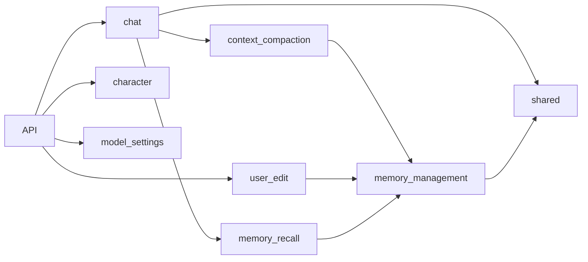

# 功能模块架构总览

图表示主要业务协作和数据关系，不表示所有模块直接调用彼此：封存会话后由记忆生产 Worker 扫描，召回和用户编辑通过自身端口读取正式数据。API 负责装配；各功能的 `core` 属于业务层，`repository` 实现业务接口。跨功能共享的技术实现位于 `storage/`。

各功能详细流程：

- [聊天](chat/ARCHITECTURE.md) · [角色](character/ARCHITECTURE.md) · [模型设置](model_settings/ARCHITECTURE.md)
- [上下文压缩](context_compaction/ARCHITECTURE.md) · [记忆管理](memory_management/ARCHITECTURE.md) · [记忆召回](memory_recall/ARCHITECTURE.md)
- [用户查询与编辑](user_edit/ARCHITECTURE.md) · [共享能力](shared/ARCHITECTURE.md)

领域数据导航见 [DOMAIN.md](DOMAIN.md)。
