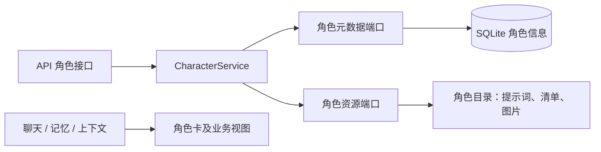
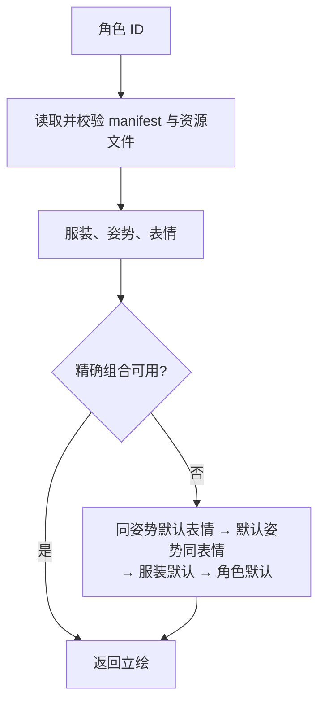

# 角色模块架构

功能见 [README](README.md)，数据见 [DOMAIN](DOMAIN.md)。

## 总览

入口是 [CharacterService](core/processing/service.py)。[SQLite 仓储](repository/sqlite.py)读取角色元数据，[文件仓储](repository/files.py)读取资源；端口位于 [ports.py](core/domain/ports.py)，API 在外层装配。

## 启动登记

应用先初始化 SQLite，再调用 `SQLiteCharacterRepository.register_manifest_characters(root)`。该方法通过 `FileCharacterRepository.discover_character_sources()` 读取 `resources/characters` 的直接子目录。带 `manifest.json` 的目录会生成一条待登记记录，目录路径按项目根目录保存。

文件仓储先校验所有清单的登记字段、角色 ID 唯一性，以及角色卡包含六节必需标题（[CharacterCardDocument.validate_selection_sections](../shared/character/document.py)）。清单无效、ID 重复或卡片缺节时会报错，登记事务尚未开始。SQLite 仓储在同一个写事务中按 ID 登记，新增缺失角色，补齐已有记录的空字段，并保留已配置的值。重复启动不会产生重复记录。

## 读取和保存提示词

编辑接口读写源模板，版本号取原文件字节的 SHA-256。保存时在 SQLite 写事务内比较版本，再通过临时文件原子替换。实现见 [FileCharacterRepository](repository/files.py)。

模型侧由 [FileReplyPromptResourceReader](../chat/reply/repository/prompt_resources.py) 加载提示词，通过 `FileCharacterRepository.read_rendered_card()` 取得渲染后的角色卡。[CharacterCardRenderer](../shared/character/card_render.py) 替换 `{{ user_name }}`，并在有清单标记时重建视觉列表。聊天回复使用全文，记忆召回、交接摘要和日记通过 `card.document.selection_view()` 取得同一份六节视图。

## 资源清单与立绘

清单校验、路径约束见 [files.py](repository/files.py)，回退顺序见 [resolve_expression](core/processing/service.py)。角色卡供记忆等功能使用的投影见 [CharacterCardDocument](../shared/character/document.py)。
