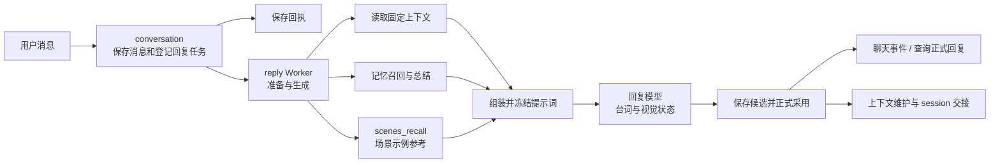
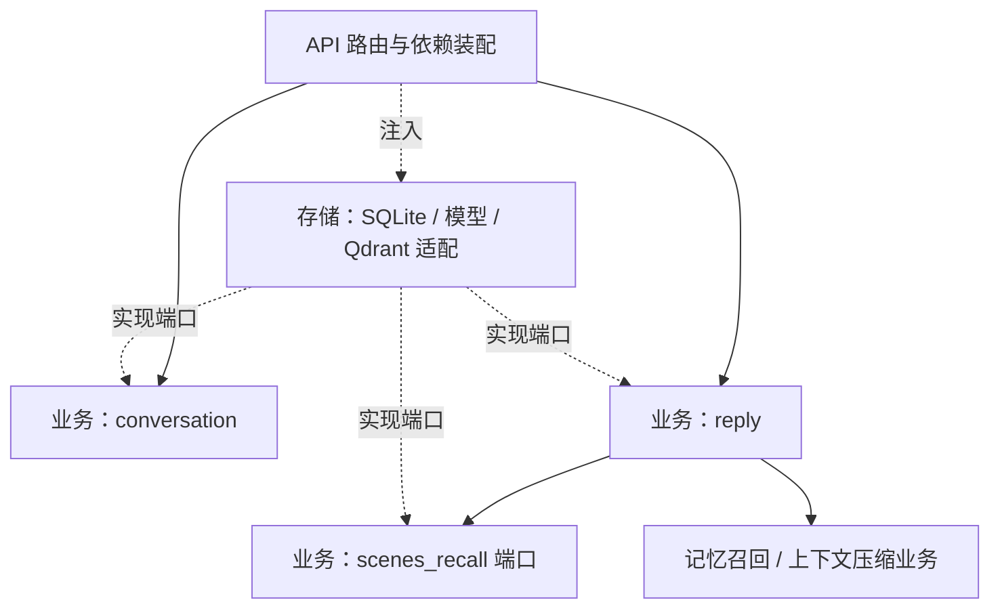
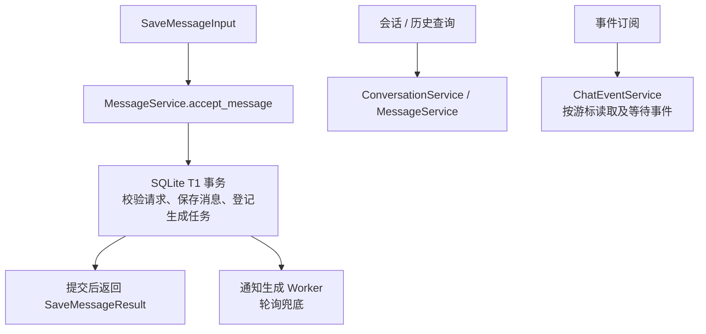
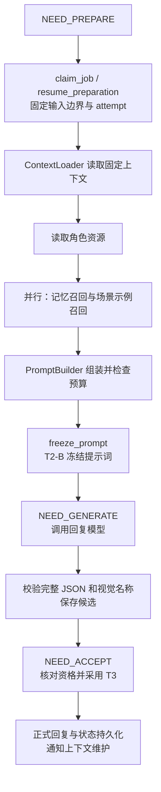
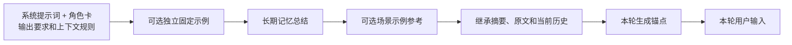
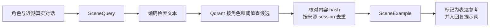

# 聊天模块架构

本文覆盖 `conversation`、`reply` 和 `scenes_recall` 的整体流程及关键代码。回复设计见 [README.md](README.md)，主要数据类型见 [DOMAIN.md](DOMAIN.md)。

## 总览

消息接收与回复生成分阶段进行：保存回执在消息事务提交后返回，后台继续处理回复。长期记忆和上下文压缩分别由 [memory_recall](../memory_recall/README.md) 与 [context_compaction](../context_compaction/README.md) 提供。

| 入口 | 关键代码 | 作用 |
| --- | --- | --- |
| 会话、消息与事件 | [conversation/core/processing](conversation/core/processing/) | 会话管理、消息接收、历史查询、事件读取。 |
| 回复准备与生成 | [GenerationWorkflow](reply/core/scheduling/workflow.py) | 驱动读取上下文、冻结提示词、生成和采用。 |
| 场景召回 | [SceneRuntime](scenes_recall/repository/runtime.py)、[QdrantSceneRecall](scenes_recall/repository/retrieval.py) | 根据角色和近期对话检索场景示例。 |
| 依赖装配 | [api/container.py](../../api/container.py) | 注入仓储、模型、上下文、记忆、场景和后台 Worker。 |

## 分层

`core/domain` 定义数据和端口，`core/processing` 处理业务，`core/scheduling` 驱动后台任务，`repository` 实现外部能力。这些是职责分组，业务层不依赖具体数据库、FastAPI 或模型 SDK。

## Conversation：消息与事件

请求回执与消息、任务的持久化属于接收事务；通知只加速任务处理。消息路由和去重的具体条件见仓储，不由前端回执推断模型已回复。

| 职责 | 关键代码 |
| --- | --- |
| 会话创建、列表与更新 | [conversations.py](conversation/core/processing/conversations.py)、[ConversationRepository](conversation/core/domain/ports.py) |
| 消息接收、历史和正式回复查询 | [messages.py](conversation/core/processing/messages.py)、[SQLiteChatRepository](conversation/repository/sqlite.py) |
| 事件读取与订阅 | [events.py](conversation/core/processing/events.py)、[事件类型](conversation/core/domain/events.py) |
| 持久化映射 | [conversation/repository/mappers.py](conversation/repository/mappers.py) |

## Reply：固定输入到正式回复

`GenerationWorkflow` 领取或恢复任务，`GenerationPreparationService` 加载上下文及角色资源，再并行准备记忆和场景。记忆结果未完整交付时不作为正常材料构建提示词。模型调用使用已冻结提示词；已有候选时可从采用阶段恢复。

| 环节 | 关键代码 | 存储入口 |
| --- | --- | --- |
| 领取与资格 | [GenerationWorkflow](reply/core/scheduling/workflow.py)、[GenerationWorker](reply/core/scheduling/worker.py) | [SQLiteGenerationRepository](reply/repository/sqlite.py) 的 `claim_job`、`check_attempt`、`resume_preparation` |
| 固定上下文 | [ContextLoader](reply/core/processing/context_loader.py)、[ContextReadRepository](reply/core/domain/context_ports.py) | [context_sqlite.py](reply/repository/context_sqlite.py) |
| 材料与提示词 | [preparation.py](reply/core/processing/preparation.py)、[PromptBuilder](reply/core/processing/prompt_builder.py)、[角色资源读取](reply/repository/prompt_resources.py) | `freeze_prompt` |
| 模型与结果 | [GenerationReplyService](reply/core/processing/service.py)、[模型适配](reply/repository/llm.py)、[CompletionService](reply/core/processing/completion.py) | `save_candidate`、`accept_reply` |
| 查询、取消、重试 | [GenerationQueryService](reply/core/processing/query.py)、[GenerationWorkflow](reply/core/scheduling/workflow.py) | `get_job`、`cancel_job`、`retry_failed_job`、`record_failure` |

### 提示词如何组织

默认锚点位于用户输入之前，固定示例拆分为对话消息；两者位置 / 格式可配置。提示词组装和预算核对见 [PromptBuilder](reply/core/processing/prompt_builder.py)，参考资料和完整轮转换见 [PromptMessage](../shared/context/types/messages.py)。

## Scenes recall：场景示例参考

全局 `reply_scene_enabled` 打开且当前角色的 `manifest.json` 将 `scene_recall_enabled` 设为 `true` 时，回复准备才会启动场景查询。角色字段缺省为 `false`，长期记忆召回独立执行。

默认阈值和返回数量见 [SceneRecallConfig](scenes_recall/core/domain/config.py)。场景导入见 [QdrantSceneIndex](scenes_recall/repository/index.py) 与 `python -m api.cli.seed_scenes`；查询见 [retrieval.py](scenes_recall/repository/retrieval.py)。场景只提供表达示例。回复采用单阶段生成，姿势和表情用本次冻结的角色视觉清单校验。

## 结果提交和恢复

正式采用时仓储核对 attempt、输入版本、采用资格及候选指纹；成功后提交正式消息和任务状态，并登记上下文维护相关动作。重试、失败和取消由 [GenerationWorkflow](reply/core/scheduling/workflow.py) 与 [SQLiteGenerationRepository](reply/repository/sqlite.py) 处理；外部模型调用不在数据库事务中。客户端可通过任务查询和聊天事件读取已提交状态，具体事件与游标语义见 [ChatEventService](conversation/core/processing/events.py)。
