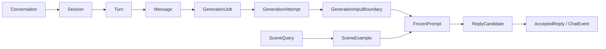
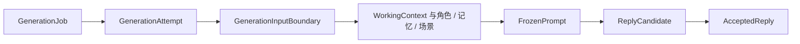

# 聊天模块领域数据

本文按消息接收、回复准备、场景参考和正式采用介绍 `conversation`、`reply`、`scenes_recall` 的主要类型。流程见 [ARCHITECTURE.md](ARCHITECTURE.md)。

## 总览

图中箭头表示业务关系和处理顺序，不表示类型之间全是字段包含关系。消息提交后后台生成回复；候选只有通过正式采用才成为可读取的回复。

## Conversation：聊天、窗口与轮次

| 类型与位置 | 作用 |
| --- | --- |
| [Conversation](conversation/core/domain/models.py) | 用户可见的持续对话，绑定角色和当前 session。 |
| [Session](conversation/core/domain/models.py) | 内部聊天窗口，记录状态、进度和前驱的继承引用。 |
| [Turn](conversation/core/domain/models.py) | 一轮输入及对应回复，记录输入版本、已采用消息与 active token。 |
| [Message](conversation/core/domain/models.py) | 单条用户或角色消息，记录角色、内容、顺序和时间。 |
| [SaveMessageInput、SaveMessageResult](conversation/core/domain/contracts.py) | 用户提交的消息及持久化回执；回执代表消息保存结果，不代表回复已生成。 |
| [ConversationDetails、ConversationMessageItem](conversation/core/domain/contracts.py) | 会话详情和消息列表的读取视图。 |
| [ChatEvent 及子类](conversation/core/domain/events.py) | 表达正式回复提交、生成失败或取消等聊天事件。 |
| [SealSession、SealSessionResult](conversation/core/domain/contracts.py) | 手动封存一段会话的输入与结果；结果带接替它的后继会话，等待超时时为空。 |

## Reply：任务、固定材料与结果

| 环节 | 类型与位置 | 用途 |
| --- | --- | --- |
| 任务及尝试 | [GenerationJob、GenerationAttempt、GenerationJobStatus](reply/core/domain/models.py) | 任务记录待处理输入版本和阶段；attempt 固定本次资格、材料与候选。 |
| 输入边界 | [GenerationInputBoundary](reply/core/domain/materials.py)、[GenerationStartTicket](reply/core/domain/contracts.py) | 固定 conversation、角色、session、历史和当前轮引用，供加载及资格检查。 |
| 加载材料 | [ReplyPromptResources](reply/core/domain/materials.py)、[WorkingContext](../shared/context/types/working.py)、[MemorySummary](../memory_recall/agent/core/domain/summary.py) | 分别提供角色资源、固定聊天上下文和记忆总结。 |
| 冻结提示词 | [PromptMessage、FrozenPrompt](reply/core/domain/materials.py)、[GenerationFreezeTicket](reply/core/domain/contracts.py) | 保存消息序列、预算结果、角色和来源版本，并用于冻结资格核对。 |
| 来源记录 | [ChatContextManifest、MemoryManifest](reply/core/domain/materials.py)、[MemoryAudit](../memory_recall/agent/core/domain/audit.py) | 固定上下文引用、记忆版本及独立的记忆审计材料。 |
| 模型输出 | [ReplyModelResponse、ModelReply、ReplyCandidate](reply/core/domain/materials.py)、[CharacterReply](../character/core/domain/models.py) | 区分模型原始返回、解析后的台词与视觉状态，以及带指纹的待采用候选。 |
| 正式采用 | [ReplyAcceptanceTicket](reply/core/domain/contracts.py)、[AcceptedReply](conversation/core/domain/contracts.py) | 前者用于核对采用资格和候选指纹；后者是已正式提交的回复结果。 |
| 任务查询与失败 | [GenerationJobResult](reply/core/domain/query.py)、[GenerationFailure](reply/core/domain/models.py) | 表示外部查询的任务视图，以及失败类别和是否可重试。 |

## Scenes recall：表达参考

| 类型与位置 | 作用 |
| --- | --- |
| [SceneQuery](scenes_recall/core/domain/models.py) | 绑定角色和用于检索的近期对话。 |
| [SceneExample](scenes_recall/core/domain/models.py) | 保存候选场景示例、上下文、回复、得分和内容哈希；它是表达参考，不代表当前聊天事实。 |
| [SceneRecallConfig](scenes_recall/core/domain/config.py) | 设置相似度阈值、候选数和最终返回数量。 |
| [SceneRecallPort](scenes_recall/core/domain/ports.py) | 定义业务所需的场景搜索能力。 |

## 共用接口与预算

| 类型与位置 | 作用 |
| --- | --- |
| [ConversationRepository、ChatRepository](conversation/core/domain/ports.py) | 定义会话、消息、回执和事件的读写能力，以及封存所需的核对、置等待与回滚。 |
| [ContextHandoffPort](conversation/core/domain/ports.py) | 定义封存所需的交接能力：登记摘要、读取任务状态、提交正常交接、提交降级交接。 |
| [GenerationRepository、ReplyModelPort、TokenCounter](reply/core/domain/ports.py) | 定义生成任务持久化、模型调用和消息 token 计数能力。 |
| [ContextReadRepository](reply/core/domain/context_ports.py) | 按固定引用读取摘要、完整轮和当前用户消息。 |
| [ContextPromptBudget](reply/core/domain/config/context_budget.py) | 定义角色卡、记忆、场景、当前输入和完整提示词的容量约束。 |
| [ReplyModelConfig](reply/core/domain/config/reply.py) | 保存回复模型、温度、输出额度、超时与思考强度配置。 |
