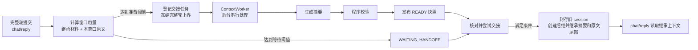
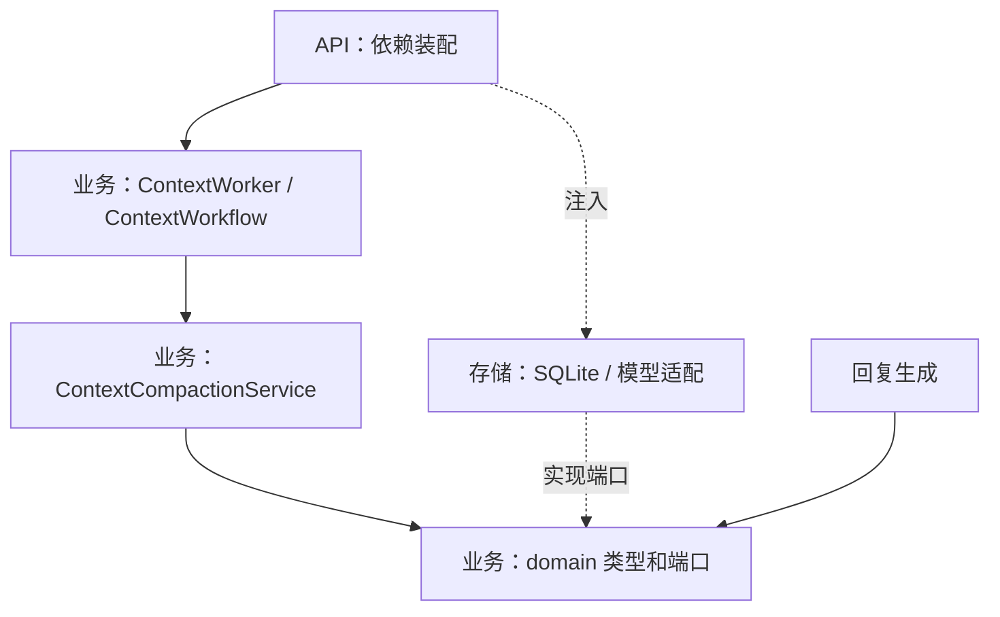
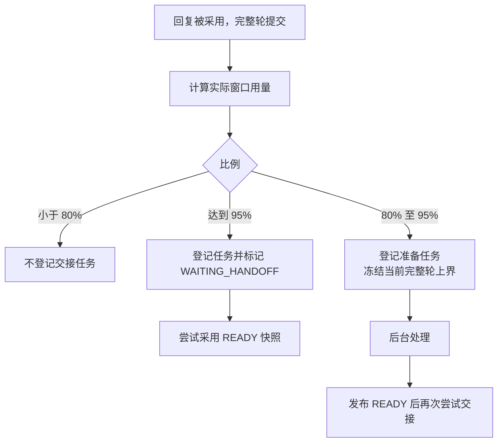
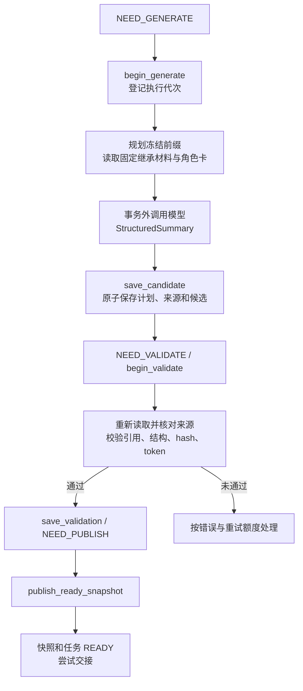
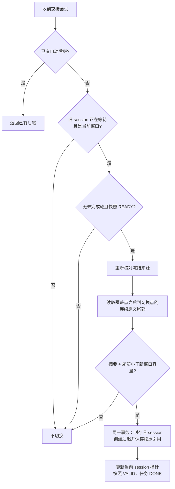
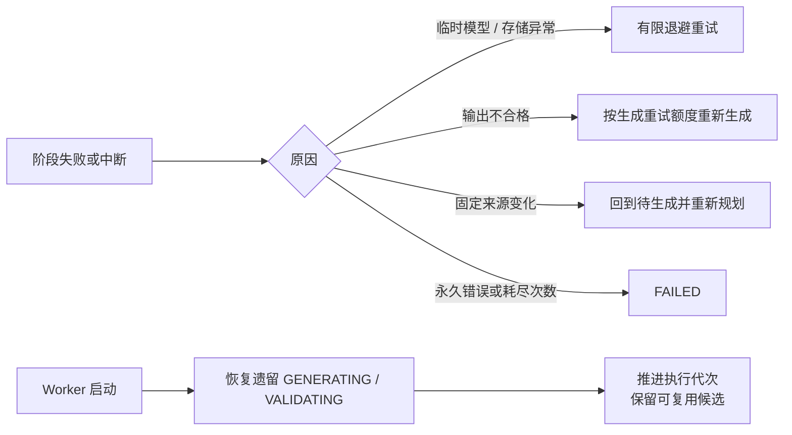

# 上下文压缩架构

本文先展示聊天、后台摘要与 session 交接的整体关系，再按阶段定位代码。功能说明见 [README.md](README.md)，数据类型见 [DOMAIN.md](DOMAIN.md)。

## 总览

一次 `conversation` 可以包含多个 session。摘要准备与聊天并行；提前 READY 不会提前切换。生成、校验和发布由后台驱动，交接可以在达到等待阈值时或 READY 发布时尝试。流程只在全部条件满足时提交。

| 阅读入口 | 关键代码 | 职责 |
| --- | --- | --- |
| 应用启动 | [api/container.py](../../api/container.py) | 装配模型、仓储、服务、Worker 和 tokenizer。 |
| 对话触发 | [chat/reply/repository/sqlite.py](../chat/reply/repository/sqlite.py) 的 `_advance_session_handoff` | 完整轮后计算用量、登记任务，必要时标记等待并尝试交接。 |
| 业务入口 | [ContextCompactionService](core/processing/service.py) | 规划来源、生成、程序校验和发布。 |
| 调度与事务 | [ContextWorker](core/scheduling/worker.py)、[ContextWorkflow](core/scheduling/workflow.py)、[SQLite 仓储](repository/sqlite.py) | 任务推进、恢复与重试；快照和交接事务。 |
| 手动封存 | [chat SessionSealService](../chat/conversation/core/processing/seal.py) | 用户主动封存时登记任务、置等待，并按状态提交正常或降级交接。 |

## 分层与依赖

`core/domain` 定义策略、任务、来源、候选、快照和端口；`core/processing` 编排规划及校验；`core/scheduling` 驱动任务。`repository` 实现业务端口并执行事务，模型和数据库细节不进入业务层。这些目录是职责分组，不是额外的运行时层。

## 触发与冻结来源

默认窗口额度 3000 token（可用 `RNA_CONTEXT_SESSION_TARGET_TOKENS`、`RNA_CONTEXT_SESSION_PREPARE_RATIO`、`RNA_CONTEXT_SESSION_HARD_RATIO` 调整）；用量为当前 session 原文加固定继承摘要及尾部的实际占用。重复登记沿用首次冻结上界。决策不拆完整轮，阈值和配置见 [SessionLifecycleConfig](core/domain/lifecycle_policy.py)；调用发生在 [回复仓储](../chat/reply/repository/sqlite.py) 的 `_advance_session_handoff`。

## 后台生成、校验与发布

规划覆盖当前 session 从第 1 轮到冻结上界的完整前缀，并使用入场时固定的继承引用；冻结之后新增的原文由交接时接续。生成目标默认 800 token，完整渲染并包装后的摘要必须非空且严格小于 1000 token；这两个数由模型输入里的 summary_target_tokens / summary_token_limit 给出，提示词不再写死。程序校验不调用审核模型，也不能证明语义准确。

| 环节 | 关键代码 | 主要仓储方法 |
| --- | --- | --- |
| 领取与调度 | [ContextWorker](core/scheduling/worker.py)、[ContextWorkflow](core/scheduling/workflow.py) | `get_next_executable_job`、`get_job` |
| 规划与生成 | [ContextCompactionService](core/processing/service.py) 校验继承边界并生成计划，[SummaryCandidate.from_summary()](core/domain/candidate.py) 构造候选。另见[摘要提示词](core/processing/prompts/summary_generation_prompt.py)和[模型适配](repository/llm.py)。 | `begin_generate`、`read_turn_token_infos`、`read_inherited_context`、`read_model_input`、`save_candidate` |
| 校验 | [ContextCompactionService.validate_candidate()](core/processing/service.py)、[StructuredSummary](../shared/context/types/summary.py) | `begin_validate`、`save_validation` |
| 发布 | [SQLite 仓储](repository/sqlite.py) | `publish_ready_snapshot`；候选、校验版本和 hash 必须对应。 |

`validate_candidate()` 将候选与固定来源、允许的引用和 token 上限交叉核对。`ContextCompactionPolicy.assess()` 根据摘要 token 数、信息保留情况和重试额度给出接受、重试或拒绝结论。

## 窗口交接

交接摘要以角色视角整理冻结前缀和固定继承材料，具体摘要字段见 [领域数据](DOMAIN.md)。摘要覆盖到准备时冻结的完整轮；之后直到实际切换点的完整原文作为尾部继承，避免聊天继续时产生的内容被遗漏。摘要生成不等待 daily 或 topic 完成。

手动封存走同一套事务，区别是封存接口会同步等后继会话（轮询 0.5 秒、最长 180 秒）。摘要重试后仍失败时，[commit_degraded_handoff](repository/sqlite.py) 放弃摘要，只把冻结上界之后的连续原文带给后继会话——要求冻结点之后确有原文、且尾部能放进新窗口，否则返回 None 交给调用方回滚。

实现见 [commit_handoff_in_transaction](repository/sqlite.py)。达到等待阈值时以及后台发布 READY 快照时都会尝试交接；事务重新核对来源、完整轮和容量，保存固定摘要引用与连续原文范围，不复制尾部消息。旧 session 封存、后继创建、conversation 指针更新及状态变更在同一事务内完成；唯一约束保证重复交接返回同一后继。READY 表示摘要已发布，DONE 表示交接已被采用；条件不满足时不切换，也不截断尾部。

## 失败与恢复

摘要任务判定 FAILED 时，等待中的封存会先尝试降级交接，避免会话停在 WAITING_HANDOFF；降级也交不出东西才回滚到可聊天。

[ContextWorkflow](core/scheduling/workflow.py) 分类错误；[SQLite 仓储](repository/sqlite.py) 的 `retry_job`、`fail_job`、`recover_unfinished_attempts` 核对状态和执行代次，防止迟到结果覆盖新进度。校验和发布阶段的可用候选可复用；启动恢复不是一次新的模型生成。

数据映射见 [repository/mappers.py](repository/mappers.py)。
