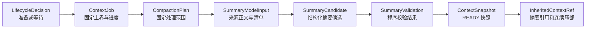
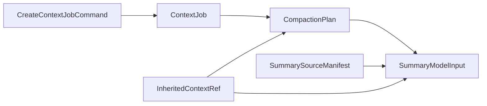
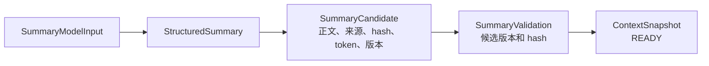
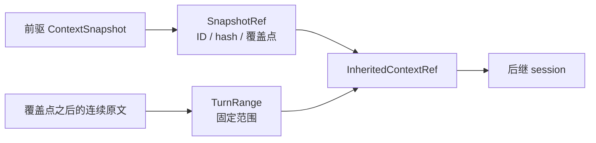

# 上下文压缩领域数据

本文按准备交接、生成摘要、校验发布和 session 继承介绍主要数据。任务执行流程见 [ARCHITECTURE.md](ARCHITECTURE.md)，功能目的见 [README.md](README.md)。

## 总览

计划记录要处理的范围，来源输入包含实际读取的材料，候选是模型结果，快照是已发布的摘要。快照 READY 不代表交接已经发生；后继 session 采用后才成为有效的继承材料。

## 窗口用量与交接决策

| 数据 | 功能与位置 |
| --- | --- |
| [SessionLifecycleConfig](core/domain/lifecycle_policy.py) | 根据当前 session 原文与继承材料的实际 token 用量，判断准备交接或等待；默认额度和阈值也在这里。 |
| [LifecycleDecision、LifecycleAction](core/domain/lifecycle.py) | 表示对某个 session、某个完整轮边界的决策；决策本身不登记任务或执行交接。 |
| [ContextCompactionPolicy、ContextModelConfig](core/domain/policy.py) | 前者定义摘要目标、严格上限和重试额度，并通过 `assess()` 返回验收结论。后者定义模型请求配置。 |
| [TurnTokenInfo](core/domain/plan.py) | 描述完整轮及累计 token 和 tokenizer 版本，供固定范围检查使用。 |

## 任务与固定来源

| 数据 | 功能与位置 |
| --- | --- |
| [CreateContextJobCommand、ContextJob](core/domain/job.py) | 前者描述登记意图；后者记录固定上界、状态、执行代次、重试及阶段产物。`attempt_version` 是执行资格版本，`attempt_count` 统计生成启动次数。 |
| [ContextJobStatus](core/domain/job.py) | 区分待生成、生成中、待校验、校验中、待发布、READY、DONE、FAILED 等状态；READY 等待交接，DONE 表示已采用。 |
| [CompactionPlan](core/domain/plan.py) | 固定本 session 需要摘要的完整轮范围、预算、策略及继承引用。当前计划覆盖第 1 轮到冻结上界，冻结后原文在交接时接续。 |
| [SummarySourceManifest](core/domain/snapshots.py) | 保存实际来源的范围、修订引用、来源哈希和固定继承引用，用于之后重新核对。 |
| [SummaryModelInput](core/domain/source.py) | 组合计划、来源清单、完整轮正文和继承内容，并限定摘要可引用的来源。 |

## 摘要、候选与校验

| 数据 | 功能与位置 |
| --- | --- |
| [SummaryModelInput](core/domain/source.py) | 传给摘要模型的固定输入：拥有的完整轮、继承材料、允许引用与预算；每条消息额外带 `local_date`（后端当地日期），约定日期按它判断，不用 `created_at` 的 UTC 日期。 |
| [StructuredSummary](../shared/context/types/summary.py) | 保存摘要主线、约定、当前话题、指代、用户情绪、未解决问题、最近话题、场景和关键词等内容，并提供解析、渲染与校验。来源引用由 [ContextSourceRef](../shared/context/types/references.py) 表达。 |
| [SummaryVersions](../shared/context/types/summary.py) | 标识摘要协议、提示词、模型和 tokenizer 版本。 |
| [SummaryCandidate](core/domain/candidate.py) | 通过 `from_summary()` 将结构化摘要、来源清单和版本信息构造成候选，同时生成正文、计算 token 数和内容哈希。 |
| [SummaryValidation](core/domain/candidate.py) | 保存程序校验结论、问题及所校验候选的版本和 hash。它不是模型对语义真实性的审核。 |
| [CompactionAssessment、CompactionOutcome](core/domain/plan.py) | 表示摘要预算等检查后的接受、重试或拒绝结论；不等于已经发布。 |
| [ContextSnapshot、SnapShotState](core/domain/snapshots.py) | 保存已发布的摘要、覆盖点、版本和来源；READY 等待采用，VALID 已采用，INVALIDATED 不可继续使用。 |

## 后继 session 的继承材料

| 数据 | 功能与位置 |
| --- | --- |
| [SnapshotRef、InheritedContextRef、ContextSourceRef](../shared/context/types/references.py) | 分别标识摘要版本、后继固定继承材料及原文修订来源；继承引用记录前驱、摘要和原文范围。 |
| [TurnRange](../shared/context/types/turns.py) | 表示某个 session 中连续轮次的范围；实际正文由读取方按引用加载。 |
| [HandoffPacket、HandoffMode](core/domain/handoff.py) | 描述交接材料及覆盖边界的领域契约；正常交接以 READY 快照和连续尾部构造 `InheritedContextRef`，降级交接只写连续尾部。 |
| [ContextMaintenanceRepository、ContextSummaryModelPort](core/domain/ports.py) | 描述业务所需的任务、来源、快照、交接及模型能力；实现位于 repository。 |

摘要重试后仍失败时走降级交接：不写 `SnapshotRef`，只继承冻结点之后的 `TurnRange`，`InheritedContextRef.summary_snapshot_ref` 为空。读取方按无摘要继承处理，会话不会因为摘要失败停在等待交接。
