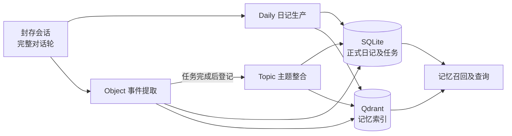
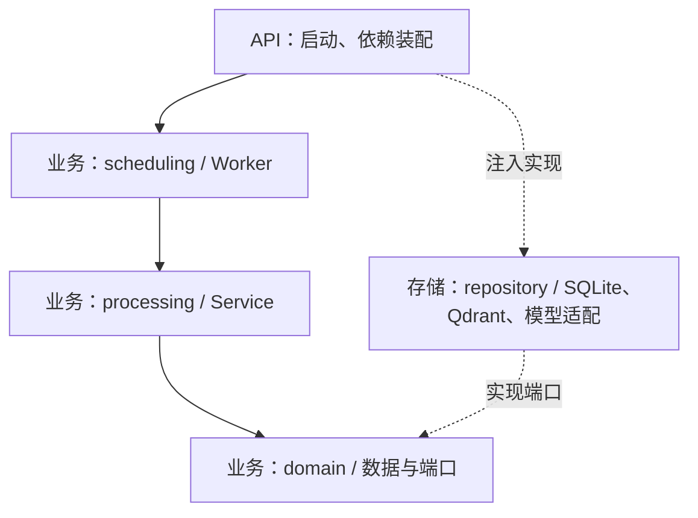
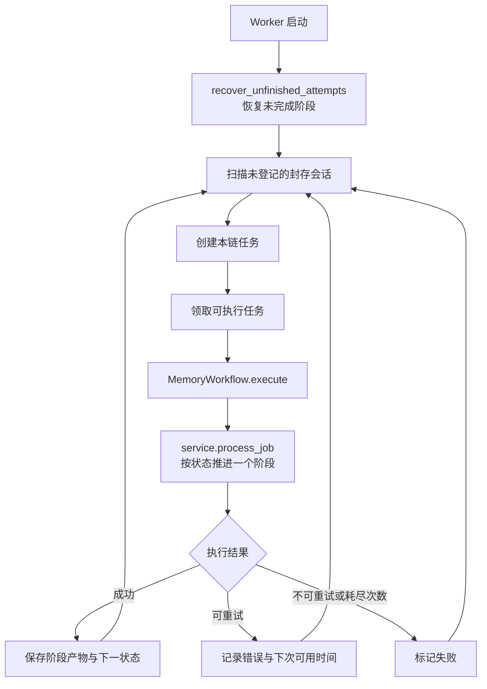
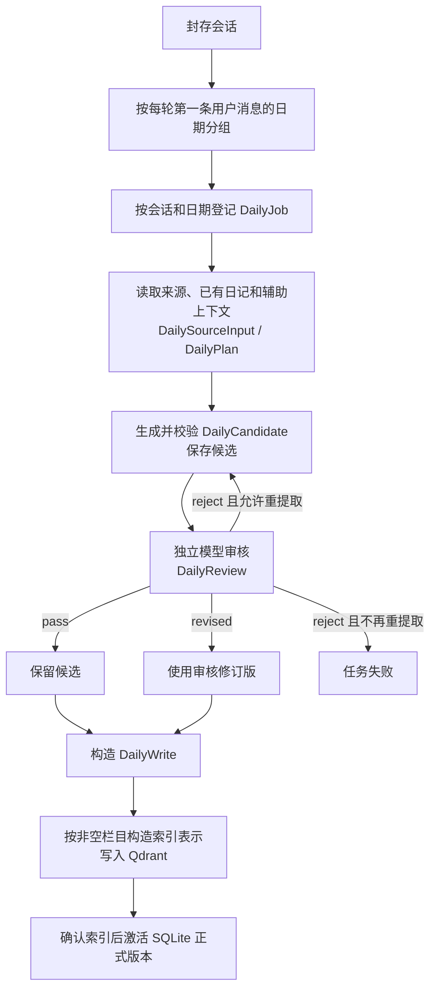
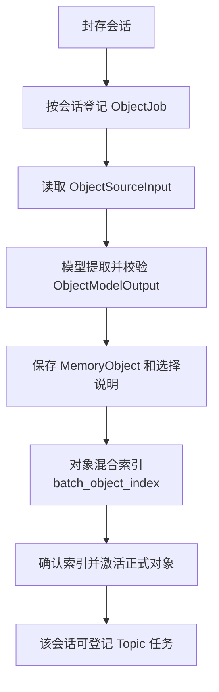
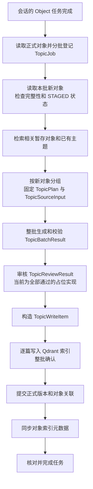
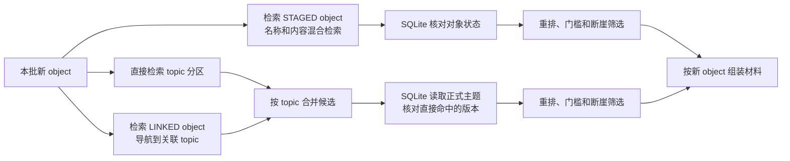
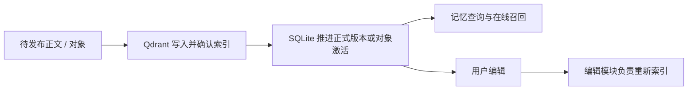

# 记忆管理架构

本文从整体流程进入代码，再分别介绍 daily、object 和 topic。图中的方法名用于定位代码；领域数据及其用途见 [DOMAIN.md](DOMAIN.md)，功能说明见 [README.md](README.md)。

## 总览：从封存会话到长期记忆

Daily 与 object 分别扫描封存会话；topic 等待对应会话的 object 任务完成后登记。三条链由各自的 Worker 驱动，共用任务调度、重试和索引能力。SQLite 保存任务进度和正式结构化数据，Qdrant 保存检索索引。记忆查询、编辑和在线召回属于相邻模块。

| 从哪里开始 | 代码 | 看什么 |
| --- | --- | --- |
| 启动入口 | [api/container.py](../../api/container.py) | 装配仓储、模型、服务与三个 Worker |
| 处理流程 | [daily service](daily/core/processing/service.py)、[object service](object/core/processing/service.py)、[topic service](topic/core/processing/service.py) | 各链登记任务及 `process_job` 的阶段分派 |
| 任务机制 | [MemoryWorkflow](shared/jobs/core/scheduling/workflow.py)、[任务仓储](shared/jobs/repository/sqlite.py) | 阶段推进、失败处理、持久化和恢复 |
| 索引实现 | [QdrantMemoryIndexRepository](shared/indexing/repository/qdrant.py) | 文档分区及 object 索引 |

## 代码分层与依赖

每条功能链内的 `core/domain` 定义业务数据和端口，`core/processing` 实现处理过程，`core/scheduling` 负责驱动；`repository` 实现端口。它们是三层架构内的职责分组，不增加运行时层。业务代码不依赖具体仓储、FastAPI、数据库驱动或模型 SDK；API 负责装配。领域数据说明见 [DOMAIN.md](DOMAIN.md)，架构检查见 [tests/test_architecture.py](../../tests/test_architecture.py)。

## 公共流程：任务登记、推进与恢复

Worker 每次轮询先登记新任务，再领取一个可执行任务。任务的目标键、幂等键、状态和执行代次保存在 `MemoryJob`；阶段开始及保存结果时核对状态与代次，避免旧执行覆盖新结果。来源变化、模型及索引错误按 [MemoryWorkflow](shared/jobs/core/scheduling/workflow.py) 分类处理；来源变化在发布开始前可触发重新生成。

| 职责 | 关键代码 |
| --- | --- |
| 各链 Worker、启动恢复及轮询 | [daily worker](daily/core/scheduling/worker.py)、[object worker](object/core/scheduling/worker.py)、[topic worker](topic/core/scheduling/worker.py) |
| 扫描和逐会话登记 | [MemoryProductionService](shared/jobs/core/processing/service.py)；各链 `register_*_jobs` |
| 任务构造、结构和状态 | 各链在自己的 `domain/job.py` 中通过任务输入类的 `create_command()` 构造 [CreateMemoryJob](shared/jobs/core/domain/job.py)，共享任务模型定义 `MemoryJob` 和 `MemoryJobStatus`。 |
| 领取、去重、恢复、重试和失败 | [MemoryJobRepository](shared/jobs/repository/sqlite.py) |

## Daily：生成和发布日记

整轮对话按第一条用户消息的后端当地日期归组。一个封存会话可按日期登记多个任务，恢复时沿用已固定的日期和消息范围。`DailySourceInput` 区分归属轮次、辅助上下文与已有日记。模型和索引调用在数据库事务外执行，审核返回 `revised` 时可使用完整修订正文。

| 阶段 | 关键代码与数据 | 仓储方法 |
| --- | --- | --- |
| 登记 | [DailyProductionService.register_daily_jobs](daily/core/processing/service.py)、[SealedSessionSource](shared/contracts/source.py)、[`DailyJobInput.create_command()`](daily/core/domain/job.py) | `read_sealed_session_source`、`register_daily_jobs_for_session` |
| 生成 | [DailySourceInput](daily/core/domain/source.py)、[DailyPlan](daily/core/domain/plan.py)、[DailyCandidate](daily/core/domain/generation.py)、[DailyDocument](daily/core/domain/document.py) | `begin_generate`、`read_daily_source`、`save_candidate` |
| 审核与正文 | [DailyReview](daily/core/domain/review.py)、[DailyWrite](daily/core/domain/publication.py) | `begin_review`、`save_review`、`begin_write`、`save_write` |
| 索引与激活 | [DailyIndexRepository](daily/repository/qdrant.py)、[公共索引实现](shared/indexing/repository/qdrant.py) | `begin_index`、`batch_hybrid_index`、`save_index`、`activate_revision` |

SQLite 方法实现在 [daily/repository/sqlite.py](daily/repository/sqlite.py)，生成和审核模型适配在 [daily/repository/llm.py](daily/repository/llm.py)；生成与审核提示词在 [prompts/](daily/core/processing/prompts/)。

## Object：从会话提取事件

`MemoryObject` 包含事件、计划和来源；事件的获知日、发生日与计划的目标日分别表示。object 链没有独立审核和正文发布阶段。

| 阶段 | 关键代码与数据 | 仓储方法 |
| --- | --- | --- |
| 登记与来源 | [ObjectProductionService](object/core/processing/service.py)、[`ObjectJobInput.create_command()`](object/core/domain/job.py)、[ObjectSourceInput](object/core/domain/source.py) | `create_job`、`begin_generate`、`read_object_source` |
| 提取与校验 | [ObjectModelOutput](object/core/domain/generation.py)、[MemoryObject](object/core/domain/document.py)、[生成提示词](object/core/processing/prompts/generation.py) | `save_extraction_result` |
| 索引与激活 | [MemoryIndexRepository](shared/indexing/core/domain/ports.py)、[Qdrant 实现](shared/indexing/repository/qdrant.py) | `begin_index`、`batch_object_index`、`save_index`、`activate_revision` |

对象 SQLite 方法见 [object/repository/sqlite.py](object/repository/sqlite.py)，模型适配见 [object/repository/llm.py](object/repository/llm.py)。

## Topic：关联事件并发布主题

默认每批最多五个新 object，新建主题默认至少需要三个不同 session 的实质讨论。生成使用 object 和已有 topic 正文与引用，不回读完整会话原文；topic 审核当前没有调用审核模型。

条目按获知日期组织：同一 session、同一获知日的同一阶段应合并为一条，按事项进展分条而不是按消息或感受分条；不同获知日、不同主体，以及事实与计划分开记录。合并时 occurrence_time / target_time 必须兼容，不为了合并丢掉明确日期，也不抹平否定和确定程度。

### Topic 的关联材料从哪里来

检索只提供候选，模型仍需判断是否属于同一事件主题。更新申请区分补充证据、修订事件、新增事件和更正；归属不清的对象可以继续暂存。`TopicPlan` 固定本批对象、相关对象和主题版本，保存生成结果时核对来源及执行代次。

| 阶段 | 关键代码与数据 | 仓储方法 |
| --- | --- | --- |
| 批量登记 | [TopicProductionService.register_topic_jobs](topic/core/processing/service.py)、[TopicProductionConfig](topic/core/processing/config.py)、[`TopicJobInput.create_command()`](topic/core/domain/job.py) | `read_sealed_session_objects`、`register_topic_jobs_for_session` |
| 关联检索 | [RelatedMemoryRetrieval](topic/core/processing/related_retrieval.py)、[检索仓储](topic/repository/retrieval.py)、[重排仓储](topic/repository/rerank.py) | `batch_object_search`、`batch_topic_search`、`batch_linked_topic_search`、`read_objects`、`read_topics` |
| 生成与审核 | [TopicPlan](topic/core/domain/plan.py)、[TopicSourceInput](topic/core/domain/source.py)、[TopicBatchResult](topic/core/domain/generation.py)、[TopicReviewResult](topic/core/domain/review.py) | `begin_generate`、`save_generation_result`、`begin_review`、`save_review` |
| 发布与激活 | [TopicWriteItem](topic/core/domain/publication.py)、[TopicDocument](topic/core/domain/document.py) | `save_write`、`save_index`、`prepare_activation`、`update_object_metadata`、`activate_revision` |

SQLite 方法实现在 [topic/repository/sqlite.py](topic/repository/sqlite.py)，模型适配和提示词分别见 [llm.py](topic/repository/llm.py) 与 [generation.py](topic/core/processing/prompts/generation.py)。主题时间窗口的纯业务规则见 [`TopicDocument.timeline_for()`](topic/core/domain/document.py)。

## 发布和相邻模块

上述是共同的阅读路径，topic 激活还包括对象关联提交及索引元数据同步，详见其流程图。Daily 索引按非空栏目生成表示；topic 为名称、身份说明和当前状态生成表示，时间线保留在正式正文中。公共索引的领域数据和端口位于 [shared/indexing/core/domain/](shared/indexing/core/domain/)，SQLite 基础设施在 [storage/sqlite/](../../storage/sqlite/)。

继续阅读：[记忆召回](../memory_recall/README.md) · [用户查询与编辑](../user_edit/memory_edit/README.md) · [领域类型划分](DOMAIN.md)。
