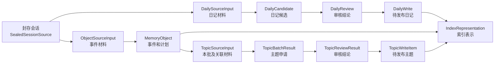
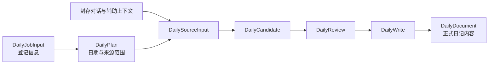
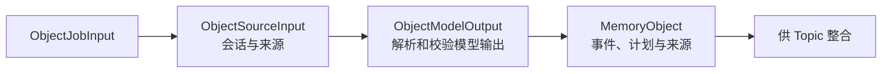
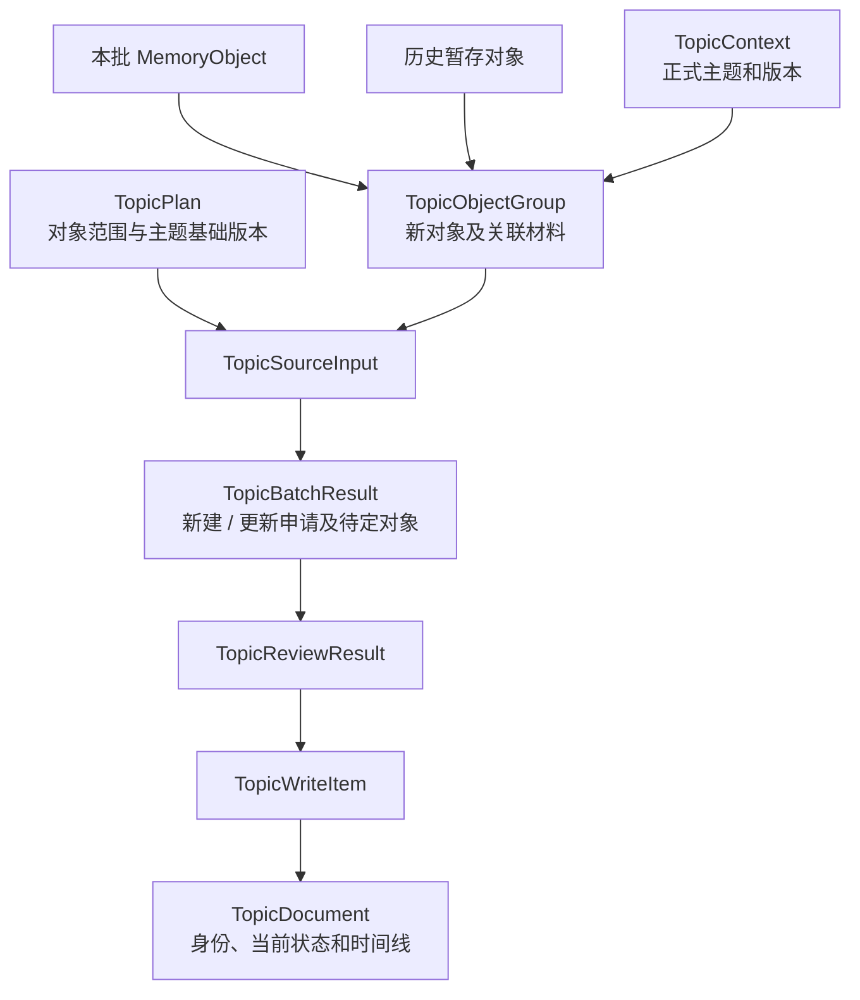
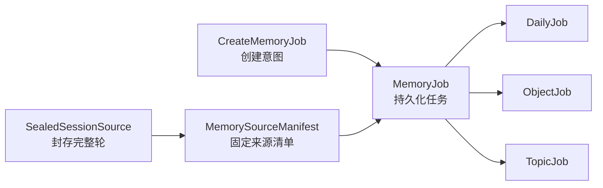

# 记忆管理领域数据

本文按功能介绍主要领域类型：数据从哪里来、在处理过程中变成什么，以及到哪里查定义。任务如何调度、仓储如何读写见 [ARCHITECTURE.md](ARCHITECTURE.md)；功能设计见 [README.md](README.md)。

## 总览

图中 object 的索引通过对象索引接口生成；`IndexRepresentation` 是 daily、topic 正文分区使用的类型，并非 object 索引输入。三个功能分别有任务记录，任务保存进度与阶段产物；正文、来源和索引表示各有不同用途。

## 业务日期与留存

时间戳通过 [`BackendTime.utc()`](../shared/common/time.py) 统一为 UTC。日记归属、留存和按日召回使用 `BackendTime.local()` 换算为运行后端的系统时区。日记任务恢复时沿用已保存的归属日期和固定来源范围。

Daily 和 Topic 正式记录以当地日期保存 `last_mentioned_at`。首次发布登记留存日期，修订沿用已登记的日期。回复首次采用时，[留存仓储](retention/repository/sqlite.py) 在同一事务内续期冻结记忆清单中的匹配版本。

[`MemoryRetentionService`](retention/core/processing/service.py) 持有 `HALF_LIFE_DAYS = 7` 和 `HOT_THRESHOLD = 0.1`。静态方法 `_evaluate_retention(last_mentioned_at, today)` 根据传入日期计算衰减分数，达到阈值时保留在热池。启动降池只检查热池记录，先同步 Qdrant 标签，再提交 SQLite 池状态。[`HotMemory`](retention/core/domain/retention.py) 保存检查所需的角色、版本引用和最后提及日期。

## Daily：从对话整理日记

| 业务环节 | 类型与位置 | 用途 |
| --- | --- | --- |
| 登记任务 | [DailyJobInput、DailyJob](daily/core/domain/job.py)、[`DailyJobInput.create_command()`](daily/core/domain/job.py) | 记录角色、会话、日期等登记参数，以及任务执行进度与阶段产物。 |
| 固定处理范围 | [DailyPlan](daily/core/domain/plan.py)、[MemorySourceManifest](shared/contracts/source.py) | 计划描述本次处理范围；来源清单固定使用的会话、消息、哈希及基础版本。 |
| 准备材料 | [DailySourceInput](daily/core/domain/source.py) | 组合计划、属于本次的完整轮、已有日记和辅助上下文。辅助上下文帮助理解，不扩大新增事实可引用的轮次范围。 |
| 生成候选 | [DailyCandidate](daily/core/domain/generation.py)、[DailyDocument](daily/core/domain/document.py) | 候选包装生成正文、版本与哈希；正文区分重要时刻、人物事实、意图、承诺和角色反思。 |
| 审核 | [DailyReview、ReviewIssue](daily/core/domain/review.py) | 保存通过、修订或拒绝及具体问题；修订版仍是完整 `DailyDocument`，不得改变日期和来源会话。 |
| 准备发布 | [DailyWrite](daily/core/domain/publication.py) | 固定审核后的正文和内容哈希，并生成非空栏目的索引表示；它本身不代表正式版本已激活。 |

`DailyDocument` 同一种类型既可承载候选内容，也可承载审核后的正文；是否已成为正式版本由任务和发布流程决定，而不是由类型名称决定。`DailyPlan` 是程序的执行计划，与日记里用户或角色的意图无关。

## Object：记录一次会话中的事件

| 业务环节 | 类型与位置 | 用途 |
| --- | --- | --- |
| 登记与执行 | [ObjectJobInput、ObjectJob](object/core/domain/job.py)、[`ObjectJobInput.create_command()`](object/core/domain/job.py) | 按会话登记提取任务并保存进度、对象及选择说明。 |
| 读取来源 | [ObjectSourceInput](object/core/domain/source.py) | 表示执行时加载的会话材料，与登记时的任务输入分开。 |
| 解析提取结果 | [ObjectModelOutput、ObjectSelectionNote](object/core/domain/generation.py) | 将模型输出校验并转换成对象，记录选择或取舍说明。 |
| 表达事件 | [MemoryObject、ObjectEvent、ObjectPlan、ObjectState](object/core/domain/document.py) | `MemoryObject` 是一件待整合的事；`ObjectEvent` 记录进展，`ObjectPlan` 记录未来打算。事件的获知日和发生日、计划的获知日和目标日分别保存，并保留来源引用。 |

对象可以处于 `STAGED`、`LINKED` 或 `DISCARDED` 状态。`ObjectPlan` 是对话中提到的计划，与 `DailyPlan`、`TopicPlan` 这类程序执行计划不同。object 没有独立的审核结果或发布正文类型。

## Topic：将事件整合为主题

| 业务环节 | 类型与位置 | 用途 |
| --- | --- | --- |
| 登记与范围 | [TopicJobInput、TopicJob](topic/core/domain/job.py)、[TopicPlan](topic/core/domain/plan.py) | 任务输入确定本批对象；计划固定新对象、关联对象、已有主题版本和新建门槛。 |
| 关联检索 | [检索领域类型](topic/core/domain/retrieval.py) | `ObjectRecallHit`、`TopicRecallHit` 及重排输入、分组结果描述候选和排序；它们不是已确认的主题归属。 |
| 组织材料 | [TopicObjectGroup、TopicContext、TopicSourceInput](topic/core/domain/source.py) | 以新对象为单位组合关联对象和已有主题正文，核对分组与计划一致。`TopicContext` 将主题正文与版本引用绑定。 |
| 提出申请 | [TopicBatchResult、TopicApplication、TopicOperation](topic/core/domain/generation.py) | 保存整批新建或更新申请以及待定对象；操作区分补充证据、修订、新增和更正，并校验申请覆盖与引用范围。 |
| 审核申请 | [TopicReviewResult、TopicApplicationReview](topic/core/domain/review.py) | 保存整批申请的审核结论。**当前审核服务直接通过，尚未调用审核模型。** |
| 准备发布 | [TopicWrite、TopicWriteItem](topic/core/domain/publication.py) | 将通过的申请转换为待发布正文，并绑定目标版本和正文哈希。 |
| 正式正文 | [TopicDocument、TopicIdentity、TopicCurrentState、TopicEntry](topic/core/domain/document.py) | 分别表达主题边界、最新状态和时间线；当前状态引用支持它的条目，更正指向保留的旧条目。 |

[时间线规则](topic/core/domain/document.py)处理窗口和过期计划等纯业务逻辑。当前生成输入包含对象与已有主题正文及来源引用，不包含完整会话原文。

## 三条流程共用的数据

### 任务与来源

| 类型与位置 | 作用 |
| --- | --- |
| [CreateMemoryJob](shared/jobs/core/domain/job.py) | 创建任务的意图，由各链任务输入类的 `create_command()` 构造。 |
| [MemoryJob、MemoryJobInput、MemoryJobStatus](shared/jobs/core/domain/job.py) | 保存共用输入、目标与幂等键、阶段、重试和执行代次。三条链的具体 Job 在此基础上保存各自的产物。 |
| [SealedSessionSource、MemorySourceManifest](shared/contracts/source.py) | 前者是封存会话的完整轮材料；后者固定实际来源及其哈希、基础版本等信息。 |
| [ReviewVerdict、ReviewSeverity](shared/contracts/review.py) | 两条审核链共用的结论和严重程度。 |
| [来源、模型和索引异常](shared/contracts/errors.py) | 让任务流程能够区分来源变化及外部能力失败。 |

### 索引

| 类型与位置 | 作用 |
| --- | --- |
| [IndexRepresentation](shared/indexing/core/domain/representation.py) | 一个待编码的正文分区，关联记忆版本、类别、文本、哈希和冷热池。 |
| [SparseVector、EmbeddingBatch、EmbeddingArtifact](shared/indexing/core/domain/embedding.py) | 描述稀疏向量、批量编码输入和编码产物。 |
| [IndexVerification](shared/indexing/core/domain/verification.py) | 描述索引核验结果。 |
| [MemoryIndexRepository](shared/indexing/core/domain/ports.py) | 定义正文与对象索引等外部能力；具体 Qdrant 操作在仓储实现中。 |
