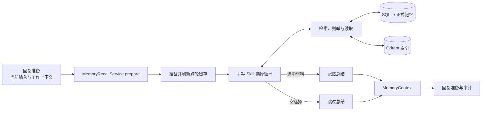
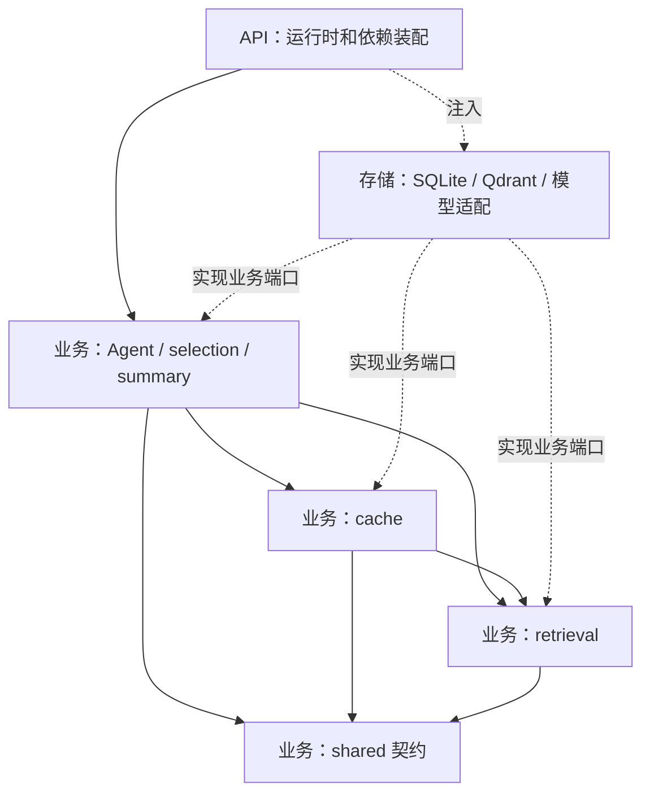
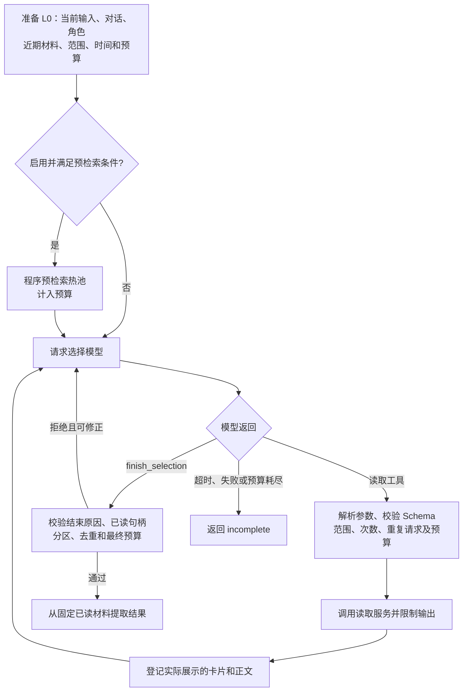
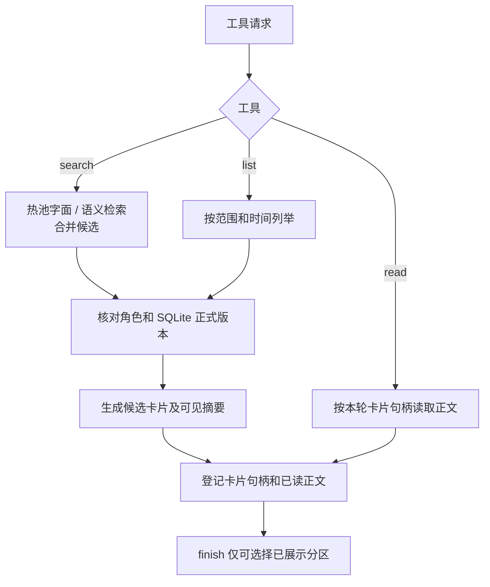
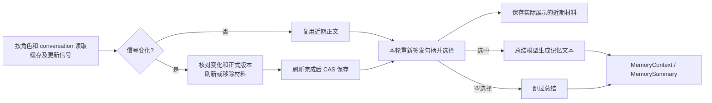

# 记忆召回架构

本文按一次召回说明流程编排、读取和缓存。功能说明见 [README.md](README.md)，领域类型见 [DOMAIN.md](DOMAIN.md)，所有类及方法见 [CODE_MAP.md](CODE_MAP.md)。

## 总览

[MemoryRecallService.prepare](agent/core/processing/service.py) 固定输入、创建读取会话，衔接缓存、选择和总结，并返回结果与来源信息。应用由 [api/container.py](../../api/container.py) 装配；调用入口在 [回复准备](../chat/reply/core/processing/preparation.py)。

### 一次召回如何编排

1. `MemoryRecallService.prepare()` 校验角色卡与本轮角色一致，从工作上下文投影真实对话和辅助摘要，再创建角色范围内的读取服务与读取会话。
2. `MemoryRecallService._run_pipeline()` 开始计算共享时限。选择回调在有会话缓存时先刷新缓存，再调用 `MemorySelectionService.select()`。该方法每轮创建独立的 `AttemptState`、选择服务实例和工具执行器。
3. `MemorySelectionService.run()` 先做空库探测（`has_documents()`，读取器快照内无任何正式文档时直接交空选择，不消耗选择模型调用）；随后执行可选的热池预检索、组装 L0 并驱动工具循环。`SelectionToolProtocol` 解析模型工具调用。`ToolExecutor` 先用 `RecallToolInputValidator` 检查 JSON 结构，再使用 `RecallToolRegistry` 中登记的输入模型和准入规则检查参数，最后执行读取并记录实际展示的材料。
4. `finish_selection` 校验成功后，从本轮已读账本提取所选分区。有选材时，`MemorySummaryService.summarize()` 在同一硬截止内调用总结网关。空选择跳过总结。输入失效时取消本轮，总结超时或失败时保留选择记录并标记未完成。
5. `prepare()` 在输入仍有效时保存可复用材料，然后返回 `MemoryContext`。回复侧从中提取 `MemorySummary` 和独立审计视图。

| 功能 | 入口 | 职责 |
| --- | --- | --- |
| Agent | [MemoryRecallService](agent/core/processing/service.py) | 输入投影、选择和总结编排、结果组装。 |
| Retrieval | [MemoryReadService](retrieval/core/processing/service.py)、[MemoryReadSession](retrieval/core/processing/session.py) | 读取正式记忆、搜索和列举，维护本轮固定材料与句柄。 |
| Cache | [MemoryCacheService](cache/core/processing/service.py) | 按更新信号刷新近期正文，并保存本轮实际展示的材料。 |
| Shared | [共享类型](shared/core/domain/) | 可见材料、固定正文、预算与错误契约。 |

## 分层与装配

`agent`、`retrieval`、`cache` 是功能分组，各自的 `core` 属于业务层，`repository` 是实现层；API 装配依赖。业务层通过端口使用模型和存储，不直接依赖具体 SDK 或数据库。正式记忆正文与生效版本来自 SQLite，检索借用共享 Qdrant 和编码资源。

## 手写 Skill 选择循环

图为逻辑顺序：代码在构造 L0 前执行可选预检索，并将结果放入 L0。模型响应中的工具调用逐个分发，结果按调用 ID 回填；`finish_selection` 独立处理，不与读取工具混合提交。接近收尾或预算不足时，仅提供提交工具；未完成不自动采用预读材料。

| 环节 | 关键代码 |
| --- | --- |
| 选择入口、循环和预检索 | [MemorySelectionService](agent/core/processing/selection/service.py) 的 `select()`、`run()`、`initial_search()`、`build_l0()` 和 `validate_finish()` |
| 工具协议与执行 | [SelectionToolProtocol](agent/core/domain/selection_protocol.py)、[RecallToolInputValidator](agent/core/processing/tools/validation.py)、[RecallToolRegistry](agent/core/processing/tools/registry.py)、[ToolExecutor](agent/core/processing/tools/executor.py) |
| 状态和限制 | [AttemptState](agent/core/domain/state.py)、[Budget](agent/core/domain/policy.py)、[RecallMaterialBudget](shared/core/domain/budgeting.py) |
| Skill 和工具定义 | [MemoryRecallResourceLoader](agent/repository/resources.py)、[Skill](agent/core/processing/prompts/memory-selection/SKILL.md)、[Schema](agent/core/processing/tools/schemas.py) |

## 检索、读取与固定材料

`MemoryReadService` 固定本轮正式文档及时间视图，读取与搜索以角色范围和正式版本为边界；`MemoryReadSession` 持有卡片、已读正文及近期记录。`search_memories` 只搜热池；`list_memories` 支持全范围列举，fallback 的准入规则见工具注册表。

| 职责 | 代码 |
| --- | --- |
| 工具业务和时间筛选 | [MemoryReadService](retrieval/core/processing/service.py) 加载 [RecallDocumentSnapshot](retrieval/core/domain/document_snapshot.py)，通过 [RecallDocument.to_recall_payload()](retrieval/core/domain/document.py) 投影正式正文，再按时区计算日期窗口和覆盖信息。 |
| 句柄、固定正文和材料提取 | [session.py](retrieval/core/processing/session.py)、[ReadLedger](retrieval/core/domain/ports.py) |
| 正式正文和向量搜索 | [SQLite 仓储](retrieval/repository/sqlite.py)、[Qdrant 仓储](retrieval/repository/qdrant.py) |
| 工具输入输出 | [search](retrieval/core/domain/tools/search.py)、[read](retrieval/core/domain/tools/read.py)、[listing](retrieval/core/domain/tools/listing.py) |

## 缓存与总结

缓存刷新未完成时只使用安全子集，不推进信号水位或覆盖持久缓存；CAS 失败不覆盖较新的结果。选择与总结共享截止时间，输入变化时取消旧尝试。总结失败时保留原选择并标记未完成，不把它当作已完成总结。

| 环节 | 代码 |
| --- | --- |
| 更新信号、刷新及保存 | [MemoryCacheService](cache/core/processing/service.py)、[SQLiteRecallCache](cache/repository/sqlite.py) |
| 选择和总结时间编排 | [MemoryRecallService._run_pipeline()](agent/core/processing/service.py)、[MemoryRecallConfig](agent/core/processing/config/pipeline.py) |
| 总结输入与模型调用 | [MemorySummaryInput.build()](agent/core/domain/summary_input.py)、[MemorySummaryService.summarize()](agent/core/processing/summary/service.py)、[总结提示词](agent/core/processing/prompts/memory-summary.md) |
| 结果及回复消费 | [MemoryContext](agent/core/domain/result.py)、[MemorySummary](agent/core/domain/summary.py)、[回复准备](../chat/reply/core/processing/preparation.py) |

## 持久化和外部适配

| 实现 | 读取与写入 |
| --- | --- |
| [SQLiteMemoryDocumentRepository](retrieval/repository/sqlite.py) | 按角色加载已发布的 Daily 和 Topic 正式正文，返回正文和版本引用。召回通过此仓储只读正式正文。 |
| [QdrantMemorySearchRepository](retrieval/repository/qdrant.py) | 使用共享编码器和索引按候选正式版本做语义搜索。命中仍以 SQLite 中对应版本的正式正文为准。 |
| [SQLiteRecallCache](cache/repository/sqlite.py) | 读取按角色和会话隔离的 `memory_recall_cache` 与 `memory_update_signals`。写缓存时比较版本，防止旧轮覆盖新结果。 |
| [RecallReaderFactory](retrieval/repository/reader_factory.py) | 为本轮装配读取服务、正式正文仓储和向量检索适配器。 |
| [MemoryRecallResourceLoader](agent/repository/resources.py) | 从模块资源目录读取 Skill 和总结提示词，并计算源文件哈希。 |
| [CompatibleMemoryModelGateway](agent/repository/llm.py) | 适配模型 SDK，发送选择或总结请求，返回规范化结果。实际运行中，选择和总结网关由 API 容器分别注入。 |
| [SQLiteGenerationRepository](../chat/reply/repository/sqlite.py) | 回复准备冻结时保存召回审计和版本引用。正式采用回复时，按实际引用的版本在同一事务内登记记忆使用。 |
