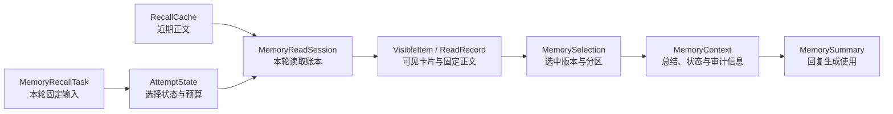
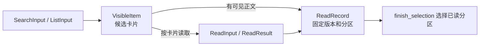
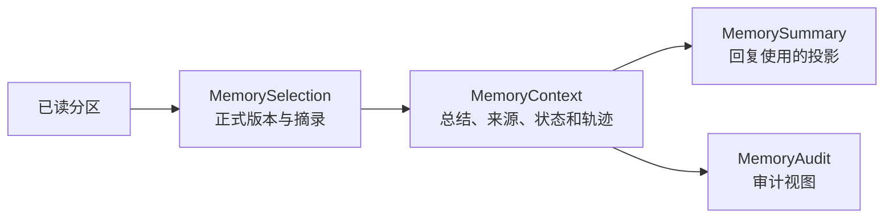

# 记忆召回领域数据

本文按一次召回的输入、选择、读取、缓存和输出介绍主要数据。流程与代码入口见 [ARCHITECTURE.md](ARCHITECTURE.md)，完整领域类与方法见 [CODE_MAP.md](CODE_MAP.md)。

## 总览

候选卡片、已读正文和最终选中的材料不是同一个概念：卡片可以只有标题，已读正文可按句柄选择，最终结果只包含通过检查的材料。

## 本轮输入与选择状态

| 类型与位置 | 功能 |
| --- | --- |
| [MemoryRecallTask](agent/core/domain/request.py) | 组合本次 attempt、角色、工作上下文、conversation 和输入有效性检查。 |
| [AttemptState](agent/core/domain/state.py) | 记录本轮模型与工具次数、截止时间、候选句柄、可见读取集和轨迹；输入过期时中止。 |
| [Budget](agent/core/domain/policy.py) | 描述工具调用、输出材料和最终选材的额度；时间目标与硬保护分别控制。 |
| [SelectionSkill、MemoryRecallResources](agent/core/domain/resources.py) | 保存 Skill 指令、总结提示词及其内容哈希，供选择和审计使用。 |
| [MemoryModelRequest、MemoryModelResult](agent/core/domain/model.py) | 通过 SDK 无关结构表达模型请求、工具及响应。 |
| [ToolSpec](agent/core/domain/tool.py) | 描述读取工具的输入类型、执行方法、结果字段、次数和准入规则。 |
| [SelectionToolProtocol](agent/core/domain/selection_protocol.py) | 提取模型工具调用，检查调用 ID 和结束批次，并解码工具参数。 |
| [MemorySummaryInput](agent/core/domain/summary_input.py) | 将已选材料、真实对话和角色规则投影成总结模型输入。 |

## 检索候选与已读材料

| 类型与位置 | 功能 |
| --- | --- |
| [SearchInput、SearchResult](retrieval/core/domain/tools/search.py) | 表达字面、语义或组合查询，以及候选卡片和覆盖信息。 |
| [ListInput、ListResult](retrieval/core/domain/tools/listing.py) | 表达按范围、时间等条件列举及结果覆盖信息。 |
| [ReadInput、ReadResult](retrieval/core/domain/tools/read.py) | 通过本轮卡片句柄请求正文，并返回读取结果或错误。 |
| [RecallDocument](retrieval/core/domain/document.py) | 绑定正式正文和版本，`to_recall_payload()` 组合正文分区与召回元数据。 |
| [RecallDocumentSnapshot](retrieval/core/domain/document_snapshot.py) | 保存本轮文档投影，提供覆盖统计、时间筛选和时间上下文。 |
| [RecallSearchTerms](retrieval/core/domain/tools/common.py) | 为搜索和列表参数共用词项规范化规则。 |
| [VisibleItem、ReadRecord、RecentRecord](shared/core/domain/records.py) | 分别表示模型看到的卡片、固定版本正文和附本轮句柄的近期记录；标题卡片不一定有可选正文。 |
| [ReadLedger、MemoryReadPort](retrieval/core/domain/ports.py) | 定义候选与已读登记、读取和检索的边界；具体账本由读取会话持有。 |

## 跨轮复用

| 类型与位置 | 功能 |
| --- | --- |
| [RecallCache、RecallCacheView](cache/core/domain/cache.py) | 缓存近期更新和近期读取正文，并携带缓存版本、更新信号水位和刷新状态；读取视图还包含待处理变化。 |
| [MemoryUpdate](cache/core/domain/update.py) | 描述记忆更新信号，供刷新时判断版本或删除状态。 |
| [RecallCachePort](cache/core/domain/ports.py) | 定义按角色和 conversation 加载、保存缓存的能力；并发保存由仓储进行版本比较。 |

缓存不保存旧 attempt 的临时句柄；重新进入选择时，本轮读取会话为可用正文重新签发句柄。

## 选择结果与回复材料

| 类型与位置 | 功能 |
| --- | --- |
| [MemorySelection、MemoryExcerpt](agent/core/domain/result.py) | 分别记录选中的正式版本引用和具体分区摘录。 |
| [MemoryContext](agent/core/domain/result.py) | 汇总选择、来源卡片、总结、完成状态、未解决问题、资源哈希与轨迹。 |
| [MemorySummary](agent/core/domain/summary.py) | 从召回结果投影出回复生成需要的总结，回复提示词不直接接收完整来源卡片。 |
| [MemoryAudit](agent/core/domain/audit.py) | 为审计提供独立视图及版本使用信息。 |
| [ErrorSpec](shared/core/domain/errors.py) | 统一可返回模型的错误代码和字段；错误结果不等同于已经成功选择材料。 |
