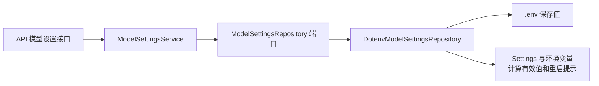
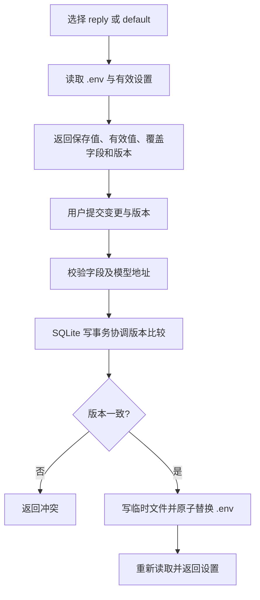

# 模型设置架构

## 总览

[ModelSettingsService](core/processing/service.py)校验请求，[DotenvModelSettingsRepository](repository/dotenv.py)实现读取和保存；[api/container.py](../../api/container.py)负责装配。

## 查询和修改

未提交字段不修改，密钥只返回是否配置；重启提示根据有效设置与应用启动时使用的设置比较。保存不等于热替换已创建的客户端。数据类型见 [DOMAIN.md](DOMAIN.md)。
