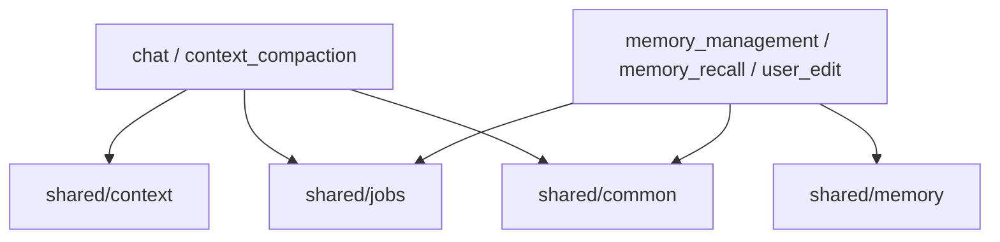
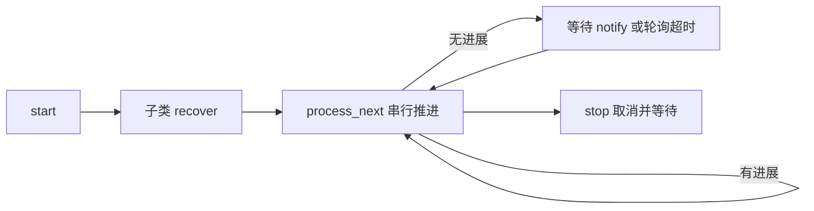

# 共享业务能力架构

共享模块提供供其他功能复用的业务契约和通用规则；不装配应用，也不实现 SQLite、模型或向量数据库。技术基础设施位于顶层 `storage/`。

## 总览

## 后台 Worker

[Worker](jobs/worker.py) 管理生命周期和唤醒，具体任务由各功能实现；[RetryPolicy](jobs/config/retry.py)提供退避配置，不代替业务 Workflow 的错误分类。共享数据位置见 [DOMAIN.md](DOMAIN.md)。
