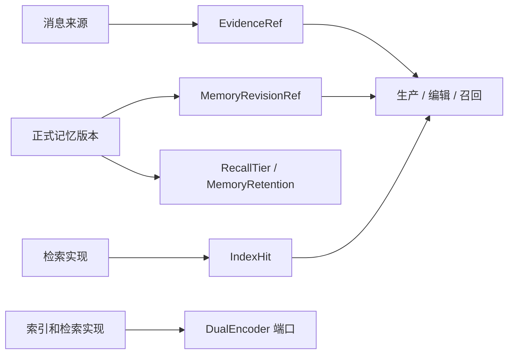

# 共享记忆契约架构

[references.py](types/references.py)定义来源与版本引用，[retention.py](types/retention.py)定义保留信息，[indexing.py](types/indexing.py)定义索引命中，[encoding.py](types/encoding.py)声明编码能力。具体正文、持久化和索引流程属于其他功能模块。领域数据见 [DOMAIN.md](DOMAIN.md)。
