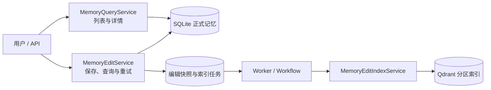
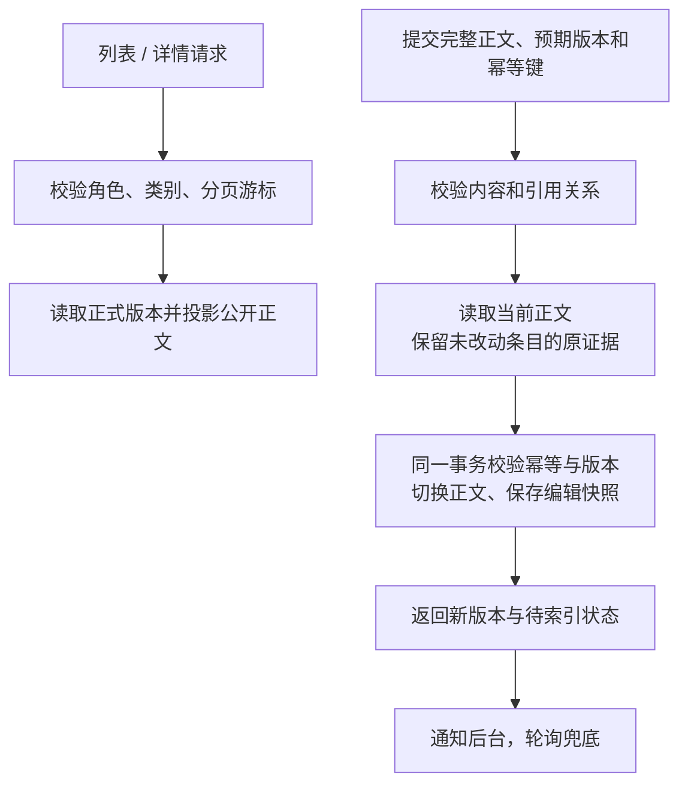
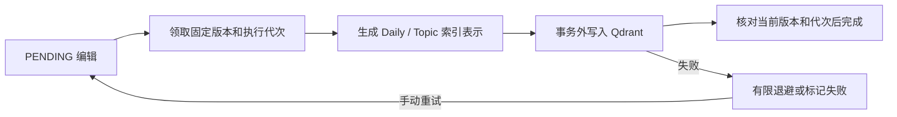

# 记忆查询与编辑架构

## 总览

API 路由见 [memories.py](../../../api/routes/memories.py) 和 [memory_edits.py](../../../api/routes/memory_edits.py)；服务与仓储由 [api/container.py](../../../api/container.py) 装配。`memory_edit` 业务定义端口，SQLite 和 Qdrant 实现在 `repository/`。

## 查询与保存

查询由 [MemoryQueryService](core/processing/query_service.py) 编排，分页游标由 [MemoryCursorCodec](core/processing/cursor.py) 编解码。[MemoryEditService](core/processing/edit_service.py) 先调用 [正文数据类](core/domain/document.py) 的 `validate()`，再读取旧版本，调用 `apply_to()` 重建正文并交给 [SQLite 仓储](repository/sqlite.py)。Daily 保留归属日期和来源会话。Topic 校验条目引用。只有未改动的正文沿用原证据。

## 后台重建索引

[MemoryEditWorker](core/scheduling/worker.py)、[MemoryEditWorkflow](core/scheduling/workflow.py) 与 [MemoryEditIndexService](core/processing/index_service.py) 推进任务；[Qdrant 实现](repository/qdrant.py)复用公共索引。正文先切版、索引后完成；失败不回退正文，新版本可使旧索引任务过时。
