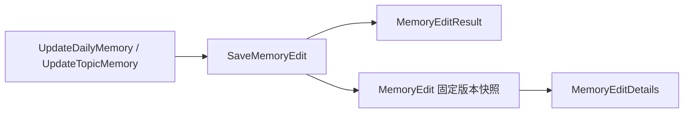

# 记忆查询与编辑领域数据

## 查询和公开正文

| 数据 | 功能与位置 |
| --- | --- |
| [DailyDocumentContent、TopicDocumentContent](core/domain/document.py) | 面向用户的日记和主题正文，不暴露内部证据。 |
| [MemoryListItem、DailyMemoryListItem、MemoryDetails](core/domain/result.py) | 分页列表、日记日期和当前正式版本的详情投影。 |
| [DocumentKind 与游标类型](core/domain/query.py) | 区分记忆类别及列表分页的定位字段。 |

## 编辑与索引

| 数据 | 功能与位置 |
| --- | --- |
| [UpdateDailyMemory、UpdateTopicMemory](core/domain/command.py) | 用户编辑意图，包含角色、文档、预期版本、幂等键及公开正文。 |
| [SaveMemoryEdit](core/domain/command.py) | 校验并保留适当证据后的内部保存命令。 |
| [MemoryEditResult、MemoryEditDetails](core/domain/result.py) | 保存结果与可查询的索引状态，不暴露内部执行快照。 |
| [MemoryEdit、MemoryEditStatus](core/domain/job.py) | 后台领取的固定正文、版本、hash 和代次，以及 pending、indexing、done、failed、obsolete 状态。 |
| [查询、编辑、任务及索引端口](core/domain/ports.py) | 分别定义正式正文读取、保存、任务推进与索引能力。 |

流程和具体实现见 [ARCHITECTURE.md](ARCHITECTURE.md)。
